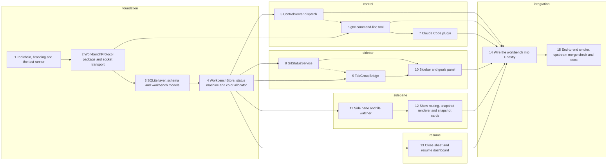

# Ghosttwriter v1 workbench: implementation plan

**Spec:** docs/specs/2026-11-09-ghosttwriter-v1.html
**Branch:** ghosttwriter-v1

Paths below are relative to the repo root. `WB` = `macos/Sources/Features/Workbench`. New files under `macos/Sources` and `macos/Tests` join their Xcode targets automatically (synchronized folder groups), so only Task 2 and Task 14 edit `project.pbxproj`.

Choices this plan makes within the spec:
- `WorkbenchProtocol` and `gtw` live in a local Swift package, `macos/gtw/`, instead of `WB/Protocol/`. Its library is linked into the app, so "compiled into both targets" holds, and `swift test` runs the CLI's tests without Xcode.
- The socket transport (`SocketListener`, `SocketClient`) lives in that package too. `ControlServer` is the app-side dispatcher on top of it.
- "Product name Ghosttwriter" is applied as the bundle display name and bundle name. `PRODUCT_NAME` stays `Ghostty` so `TEST_HOST`, `build.nu` and upstream scripts keep working; the built bundle stays `Ghostty.app`.
- The `WorkbenchStore` additions beyond spec 6.4 are listed in Task 4's Interfaces.

App test command (created in Task 1): `macos/scripts/workbench-test <SuiteName>`
Package test command: `swift test --package-path macos/gtw --filter <SuiteName>`

## Constraints
1. macOS 14 or later only. No changes under `src/` (Zig) or `pkg/`.
2. Bundle id `com.jonmoses.ghosttwriter`, product name `Ghosttwriter`, Sparkle updates off.
3. Ghosttwriter reads the same `~/.config/ghostty/config` as Ghostty, and adds no new Ghostty config keys.
4. No native tab bar is ever visible in a Ghosttwriter window. The tab-group order always matches the sidebar order top to bottom, so ⌘1–⌘9 select the 1st–9th sidebar rows.
5. Sidebar width defaults to 240 pt, can be dragged between 180 and 400 pt, and is remembered in UserDefaults key `workbench.sidebarWidth`.
6. Side pane width defaults to 45% of the window, can be dragged between 25% and 70%, and is remembered in `workbench.sidePaneFraction`.
7. Shortcuts: ⌘⌥S toggles the sidebar, ⌘⌥P toggles the side pane, ⌘⌥R opens the resume dashboard, and ⌘⌥G focuses the goal add field.
8. Each sidebar row shows, in order: color dot, title, cwd basename, branch with ↑ahead ↓behind, a dirty marker ● if staged + unstaged + untracked > 0, a status badge, and goal progress "done/total" when total > 0.
9. Rows are grouped by git toplevel, with the group label being the basename of the repo root. Non-repo tabs go in a group labelled "Other". Pinned rows show only in the Pinned section at the top.
10. Rows can be reordered by dragging only within their own group. Groups can be reordered by dragging their headers.
11. Git status refreshes on a pwd change and every 5 s for repos visible in the key window. Each run has a 2 s timeout, at most 4 git processes run at once, and a timed-out repo shows "?" instead of counts.
12. Status badges: working = spinner, waiting = hollow dot, needs_input = orange "!", done = ✓, idle = no badge.
13. Colors: a new tab gets the least-used of the 8 Claude colors among live tabs, with ties broken at random. Splits inherit their tab's color.
14. `gtw hook` sends at most 64 KB of stdin. It gives up after 500 ms when it can't reach the socket, and always exits 0.
15. The ControlServer handles each request in under 50 ms on the main actor, not counting `show` rendering, which runs asynchronously with a 5 s limit.
16. The close sheet appears only for ⌘W / Close Tab on a tab with a non-idle session that is not done. It replaces Ghostty's own confirm alert there. All other closes save without asking.
17. The close sheet's note is prefilled with the existing note, or else "- " + each unchecked goal on its own line.
18. Resuming opens a new tab in the record's cwd with `TABCOLOR` set to the record's color and the record reattached. If the record has a `claude_session_id`, the tab also types the initial input `claude --resume <claude_session_id>\n`. If it has none (goals were typed but Claude never started), no input is typed.
19. Closed records are kept for 90 days or until there are 500 of them, whichever comes first, and pruning happens at launch. Goal events are deleted together with their record.
20. Inline rule: HTML goes inline only if the file is ≤ 200 KB, contains no `<script`, and has `scrollHeight` ≤ 600 px at a render width of min(terminal width − 24 pt, 1000 pt). Otherwise it opens in the pane.
21. A tab's SnapshotCard stack holds at most 3 cards. A new card pushes out the oldest.
22. Side pane reloads are debounced by 150 ms after the last file event and keep the scroll position (HTML/MD) or page (PDF).
23. Markdown rendering uses bundled markdown-it 14.1.0 and mermaid 11.4.1 from app resources and makes no network requests.
24. The socket has mode 0600 and the directory 0700. Requests over 1 MB are rejected.

## Review focus
- After Claude's `/clear` (SessionStart with source `clear`), the session keeps its goals and note under the new id: `WorkbenchStoreTests.clearRelinksAndKeepsGoals` (Task 4).
- A SessionStart(resume) hook that arrives after the dashboard has already reattached the record creates no duplicate record: `WorkbenchStoreTests.resumeHookAfterReattachKeepsOneRecord` (Task 4).
- Goal indices are 1-based and follow display order after a removal, so `gtw goal done 2` checks the goal the user sees as number 2: `WorkbenchStoreTests.indicesFollowDisplayOrderAfterRemove` (Task 4).
- An editor that saves by writing a temp file and renaming it still triggers a side-pane reload: `FileWatcherTests.atomicRenameTriggersChange` (Task 11).
- `gtw hook` with the app not running, or for a surface the app doesn't know, prints nothing and exits 0: `GtwCoreTests.hookIsSilentWhenUnreachable` (Task 6).

## Tracks
| Track | Tasks | Runs |
|---|---|---|
| foundation | 1, 2, 3, 4 | first, alone |
| control | 5, 6, 7 | in parallel |
| sidebar | 8, 9, 10 | in parallel |
| sidepane | 11, 12 | in parallel |
| resume | 13 | in parallel |
| integration | 14, 15 | last, alone |

<!-- graph:start -->

<!-- graph:end -->

## Task 1: Toolchain, branding and the test runner

**Track:** foundation
**Depends on:** none
**Files:**
- Create: macos/scripts/workbench-test
- Modify: macos/Ghostty.xcodeproj/project.pbxproj
- Modify: macos/Ghostty-Info.plist
- Modify: macos/Sources/App/AppDelegate.swift
- Test: macos/Tests/Workbench/BrandingTests.swift
**Interfaces:**
- Produces: `macos/scripts/workbench-test <Suite>` (runs `xcodebuild … -only-testing:GhosttyTests/<Suite> test` with the same clean env as `macos/build.nu`)
- Consumes: none

- [ ] **Step 1: Write the failing test**
```swift
import Foundation
import Testing
@testable import Ghostty

struct BrandingTests {
    @Test func bundleIdentifierIsGhosttwriter() {
        #expect(Bundle.main.bundleIdentifier?.hasPrefix("com.jonmoses.ghosttwriter") == true)
    }

    @Test func displayNameIsGhosttwriter() {
        let name = Bundle.main.object(forInfoDictionaryKey: "CFBundleDisplayName") as? String
        #expect(name?.hasPrefix("Ghosttwriter") == true)
    }

    @Test func automaticUpdateChecksAreOff() {
        #expect(Bundle.main.object(forInfoDictionaryKey: "SUEnableAutomaticChecks") as? Bool == false)
    }
}
```
- [ ] **Step 2: Run it, expect failure**
First get the toolchain building. Install Zig 0.17.0: `brew install zig`, and if `zig version` is not 0.17.x, use the 0.17.0 tarball from ziglang.org on `PATH`. Install nushell (`brew install nushell`) if `nu` is missing. Then build the core library once with `zig build -Demit-macos-app=false`, and run `macos/build.nu --action test` to confirm the stock tests pass before any change.
Write `macos/scripts/workbench-test`:
```sh
#!/bin/sh
# Run one GhosttyTests suite with the same clean environment as build.nu.
set -eu
here=$(cd "$(dirname "$0")/.." && pwd)
[ $# -eq 1 ] || { echo "usage: workbench-test SUITE" >&2; exit 2; }
exec env -i HOME="$HOME" PATH=/usr/bin:/bin:/usr/sbin:/sbin \
  xcodebuild -project "$here/Ghostty.xcodeproj" -scheme Ghostty -configuration Debug \
  SYMROOT="$here/build" -skip-testing GhosttyUITests "-only-testing:GhosttyTests/$1" test
```
`chmod +x` it.
Run: `macos/scripts/workbench-test BrandingTests`  Expected: `** TEST FAILED **`. All three expectations fail: the identifier is `com.mitchellh.ghostty.debug`, the display name is `Ghostty[DEBUG]`, and `SUEnableAutomaticChecks` is true.
- [ ] **Step 3: Implement**
- In `project.pbxproj`, for the Ghostty target only:
  * `PRODUCT_BUNDLE_IDENTIFIER`: `com.mitchellh.ghostty` → `com.jonmoses.ghosttwriter` and `com.mitchellh.ghostty.debug` → `com.jonmoses.ghosttwriter.debug`.
  * `INFOPLIST_KEY_CFBundleDisplayName`: `Ghostty` → `Ghosttwriter` and `Ghostty[DEBUG]` → `Ghosttwriter[DEBUG]`.
  * Leave `PRODUCT_NAME`, the DockTilePlugin, and the test targets' ids unchanged.
- In `Ghostty-Info.plist`: set `SUEnableAutomaticChecks` to false, remove `SUFeedURL` if present, and set `CFBundleName` to `Ghosttwriter`.
- In `AppDelegate.swift`: don't start the Sparkle updater. Leave the `UpdateController` type in place, but skip its start call and hide the "Check for Updates" menu item.
- [ ] **Step 4: Run the tests, expect pass**
Run `macos/scripts/workbench-test BrandingTests`, then the full `macos/build.nu --action test`.
- [ ] **Step 5: Commit**
git commit -m "macos: rebrand to Ghosttwriter, disable Sparkle, add workbench-test runner"

## Task 2: WorkbenchProtocol package and socket transport

**Track:** foundation
**Depends on:** Task 1
**Files:**
- Create: macos/gtw/Package.swift
- Create: macos/gtw/Sources/WorkbenchProtocol/Types.swift
- Create: macos/gtw/Sources/WorkbenchProtocol/WireCodec.swift
- Create: macos/gtw/Sources/WorkbenchProtocol/SocketListener.swift
- Create: macos/gtw/Sources/WorkbenchProtocol/SocketClient.swift
- Test: macos/gtw/Tests/WorkbenchProtocolTests/ProtocolTests.swift
- Test: macos/gtw/Tests/WorkbenchProtocolTests/SocketTests.swift
- Modify: macos/Ghostty.xcodeproj/project.pbxproj
- Test: macos/Tests/Workbench/WorkbenchProtocolLinkTests.swift
**Interfaces:**
- Produces: `ClaudeColor` (`public enum ClaudeColor: String, CaseIterable, Codable, Sendable { case red, blue, green, yellow, purple, orange, pink, cyan }`)
- Produces: `Author` (`public enum Author: String, Codable, Sendable { case user, claude }`)
- Produces: `SessionStatus` (`public enum SessionStatus: String, Codable, Sendable { case idle, waiting, working, needsInput = "needs_input" }`)
- Produces: `ShowMode` (`public enum ShowMode: String, Codable, Sendable { case auto, pane, inline }`), `ShowPlacement` (`public enum ShowPlacement: String, Codable, Sendable { case pane, card, tty }`)
- Produces: `JSONValue` (`public enum JSONValue: Codable, Equatable, Sendable { case string(String), int(Int), bool(Bool), double(Double), array([JSONValue]), object([String: JSONValue]), null }`)
- Produces: `Request` (`public struct Request: Codable, Equatable, Sendable { public var v: Int; public var op: String; public var surface: String; public var author: Author; public var args: [String: JSONValue] }` with `func string(_ key: String) -> String?`, `func int(_ key: String) -> Int?`, `func bool(_ key: String) -> Bool?`)
- Produces: `Response` (`public struct Response: Codable, Equatable, Sendable { public var ok: Bool; public var data: [String: JSONValue]?; public var error: String?; static func success(_ data: [String: JSONValue] = [:]) -> Response; static func failure(_ message: String) -> Response }`)
- Produces: `WireOp` (`public enum WireOp: String, CaseIterable { case hook, goalAdd = "goal.add", goalDone = "goal.done", goalUndo = "goal.undo", goalRm = "goal.rm", goalList = "goal.list", noteSet = "note.set", statusSet = "status.set", show, colorSet = "color.set", info }`)
- Produces: `WireCodec` (`public enum WireCodec { static let protocolVersion = 1; static let maxRequestBytes = 1_048_576; static func encode<T: Encodable>(_ value: T) throws -> Data /* JSON + "\n" */; static func decodeRequest(_ line: Data) throws -> Request; static func decodeResponse(_ line: Data) throws -> Response }`)
- Produces: `ProtocolError` (`public enum ProtocolError: Error, Equatable { case badVersion(Int), tooLarge, malformed(String) }`)
- Produces: `SocketPaths` (`public enum SocketPaths { static func defaultSocket(home: String) -> String /* "<home>/Library/Application Support/Ghosttwriter/gtw.sock" */ }`)
- Produces: `SocketListener` (`public final class SocketListener: @unchecked Sendable { public init(path: String, handler: @escaping @Sendable (Data) async -> Data) throws; public func start() throws; public func stop() }`)
- Produces: `SocketClient` (`public enum SocketClient { static func send(_ request: Request, socketPath: String, timeout: TimeInterval) throws -> Response }`), `SocketClientError` (`public enum SocketClientError: Error { case unreachable, timedOut, badReply }`)
- Consumes: none

- [ ] **Step 1: Write the failing test**
`macos/gtw/Tests/WorkbenchProtocolTests/ProtocolTests.swift`:
```swift
import Foundation
import Testing
@testable import WorkbenchProtocol

struct ProtocolTests {
    @Test func requestRoundTrips() throws {
        let r = Request(v: 1, op: "goal.add", surface: "S1", author: .claude, args: ["text": .string("ship it")])
        let data = try WireCodec.encode(r)
        #expect(data.last == UInt8(ascii: "\n"))
        let back = try WireCodec.decodeRequest(data.dropLast())
        #expect(back == r)
        #expect(back.string("text") == "ship it")
    }

    @Test func everyOpRoundTrips() throws {
        for op in WireOp.allCases {
            let r = Request(v: 1, op: op.rawValue, surface: "S", author: .user, args: [:])
            #expect(try WireCodec.decodeRequest(WireCodec.encode(r).dropLast()) == r)
        }
    }

    @Test func badVersionIsRejected() {
        let line = Data(#"{"v":2,"op":"info","surface":"S","author":"user","args":{}}"#.utf8)
        #expect(throws: ProtocolError.badVersion(2)) { try WireCodec.decodeRequest(line) }
    }

    @Test func oversizeIsRejected() {
        let line = Data(repeating: UInt8(ascii: " "), count: WireCodec.maxRequestBytes + 1)
        #expect(throws: ProtocolError.tooLarge) { try WireCodec.decodeRequest(line) }
    }

    @Test func colorsAreClaudesEight() {
        #expect(ClaudeColor.allCases.map(\.rawValue) == ["red", "blue", "green", "yellow", "purple", "orange", "pink", "cyan"])
        #expect(SessionStatus.needsInput.rawValue == "needs_input")
    }

    @Test func defaultSocketPath() {
        #expect(SocketPaths.defaultSocket(home: "/Users/x") == "/Users/x/Library/Application Support/Ghosttwriter/gtw.sock")
    }
}
```
`macos/gtw/Tests/WorkbenchProtocolTests/SocketTests.swift`:
```swift
import Foundation
import Testing
@testable import WorkbenchProtocol

struct SocketTests {
    func tempSocket() -> String {
        let dir = FileManager.default.temporaryDirectory.appendingPathComponent("gtw-\(UUID().uuidString.prefix(8))")
        return dir.appendingPathComponent("gtw.sock").path
    }

    @Test func roundTripAndModes() throws {
        let path = tempSocket()
        let l = try SocketListener(path: path) { line in
            let req = try! WireCodec.decodeRequest(line)
            return try! WireCodec.encode(Response.success(["op": .string(req.op)]))
        }
        try l.start(); defer { l.stop() }
        let resp = try SocketClient.send(Request(v: 1, op: "info", surface: "S", author: .user, args: [:]), socketPath: path, timeout: 1)
        #expect(resp.ok && resp.data?["op"] == .string("info"))
        let sockMode = try FileManager.default.attributesOfItem(atPath: path)[.posixPermissions] as? Int
        let dirMode = try FileManager.default.attributesOfItem(atPath: (path as NSString).deletingLastPathComponent)[.posixPermissions] as? Int
        #expect(sockMode == 0o600 && dirMode == 0o700)
    }

    @Test func oversizeGetsFailureReply() throws {
        let path = tempSocket()
        let l = try SocketListener(path: path) { _ in try! WireCodec.encode(Response.success()) }
        try l.start(); defer { l.stop() }
        let big = Request(v: 1, op: "note.set", surface: "S", author: .user,
                          args: ["text": .string(String(repeating: "x", count: WireCodec.maxRequestBytes))])
        let resp = try SocketClient.send(big, socketPath: path, timeout: 2)
        #expect(resp.ok == false && resp.error == "request too large")
    }

    @Test func unreachableSocketThrows() {
        #expect(throws: SocketClientError.unreachable) {
            try SocketClient.send(Request(v: 1, op: "info", surface: "S", author: .user, args: [:]), socketPath: "/tmp/nope-\(UUID()).sock", timeout: 0.5)
        }
    }
}
```
`macos/Tests/Workbench/WorkbenchProtocolLinkTests.swift`:
```swift
import Testing
import WorkbenchProtocol
@testable import Ghostty

struct WorkbenchProtocolLinkTests {
    @Test func appLinksWorkbenchProtocol() {
        #expect(ClaudeColor.allCases.count == 8)
    }
}
```
- [ ] **Step 2: Run it, expect failure**
Run: `swift test --package-path macos/gtw --filter ProtocolTests`  Expected: `error: could not find Package.swift` (and once that exists, `cannot find 'WireCodec' in scope`).
- [ ] **Step 3: Implement**
- `Package.swift`: swift-tools-version 6.0, `platforms: [.macOS(.v14)]`, a library product `WorkbenchProtocol`, a target `WorkbenchProtocol` and a test target `WorkbenchProtocolTests`. Task 6 adds `GtwCore` and `gtw`.
- `WireCodec.decodeRequest`:
  * check the size first (`count > maxRequestBytes` → `.tooLarge`);
  * decode JSON (on failure → `.malformed(description)`);
  * then check `v == protocolVersion` (else `.badVersion(v)`).
- `SocketListener` uses POSIX `socket(AF_UNIX, SOCK_STREAM)`:
  * It creates the parent directory with 0700 and unlinks a stale socket at `path`.
  * It does `bind`, `chmod 0600` and `listen`, and accepts on a background thread.
  * Per connection, it reads until `\n` or until `maxRequestBytes + 1` bytes. Over the limit, it replies `Response.failure("request too large")` without calling the handler; otherwise it calls `handler(line)`, then writes the reply and closes.
  * `stop()` closes the socket and unlinks the path.
- `SocketClient.send`:
  * `connect` fails → `.unreachable`.
  * Set `SO_SNDTIMEO`/`SO_RCVTIMEO` to `timeout`; a timeout → `.timedOut`.
  * Write the encoded request, read one line, decode it; a bad reply → `.badReply`.
- In `project.pbxproj`, add `XCLocalSwiftPackageReference` `gtw` (relative path `gtw`) and add the product `WorkbenchProtocol` to the Frameworks of the Ghostty and GhosttyTests targets.
- [ ] **Step 4: Run the tests, expect pass**
Run `swift test --package-path macos/gtw` and `macos/scripts/workbench-test WorkbenchProtocolLinkTests`.
- [ ] **Step 5: Commit**
git commit -m "gtw: add WorkbenchProtocol package with wire codec and unix socket transport"

## Task 3: SQLite layer, schema and workbench models

**Track:** foundation
**Depends on:** Task 2
**Files:**
- Create: macos/Sources/Features/Workbench/Store/SQLiteDB.swift
- Create: macos/Sources/Features/Workbench/Store/WorkbenchSchema.swift
- Create: macos/Sources/Features/Workbench/Store/Models.swift
- Test: macos/Tests/Workbench/SQLiteDBTests.swift
**Interfaces:**
- Produces: `SQLValue` (`enum SQLValue: Equatable { case null, int(Int64), real(Double), text(String) }`)
- Produces: `SQLiteDB` (`final class SQLiteDB { init(path: String) throws; func exec(_ sql: String) throws; func run(_ sql: String, _ params: [SQLValue] = []) throws; func query(_ sql: String, _ params: [SQLValue] = []) throws -> [[String: SQLValue]]; func transaction<T>(_ body: () throws -> T) throws -> T; var lastInsertRowID: Int64 { get }; func userVersion() throws -> Int }`)
- Produces: `SQLiteError` (`struct SQLiteError: Error { let code: Int32; let message: String }`)
- Produces: `WorkbenchSchema` (`enum WorkbenchSchema { static let version = 1; static func migrate(_ db: SQLiteDB) throws }`)
- Produces: `SessionRecord` (`struct SessionRecord: Identifiable, Equatable { var id: UUID; var claudeSessionId: String?; var surfaceId: UUID?; var cwd: String; var repoRoot: String?; var title: String; var color: ClaudeColor; var status: SessionStatus; var manualDone: Bool; var note: String; var goals: [Goal]; var createdAt: Date; var updatedAt: Date; var closedAt: Date? }`)
- Produces: `Goal` (`struct Goal: Identifiable, Equatable { var id: Int64; var text: String; var done: Bool; var author: Author; var createdAt: Date; var doneAt: Date? }`)
- Produces: `GoalEvent` (`struct GoalEvent: Identifiable, Equatable { var id: Int64; var goalId: Int64?; var kind: GoalEventKind; var text: String; var author: Author; var at: Date }`), `GoalEventKind` (`enum GoalEventKind: String { case add, done, undo, remove, relinked, note }`)
- Produces: `GitState` (`struct GitState: Equatable { var branch: String; var ahead: Int; var behind: Int; var staged: Int; var unstaged: Int; var untracked: Int; var timedOut: Bool = false; var isDirty: Bool { staged + unstaged + untracked > 0 } }`)
- Produces: `HookEvent` (`struct HookEvent: Equatable { var name: String; var sessionId: String; var cwd: String; var source: String?; var message: String? }`)
- Produces: `LiveSurface` (`struct LiveSurface: Equatable { var id: UUID; var cwd: String; var title: String; var color: ClaudeColor }`)
- Produces: `Badge` (`enum Badge: Equatable { case none, spinner, hollow, attention, done }`)
- Produces: `ShowPresenter` (`@MainActor protocol ShowPresenter: AnyObject { func show(path: String, mode: ShowMode, tty: Bool, surface: UUID) async throws -> ShowResult }`), `ShowResult` (`struct ShowResult: Equatable { var placed: ShowPlacement; var png: String? }`)
- Produces: `WorkbenchError` (`enum WorkbenchError: Error, Equatable, CustomStringConvertible { case unknownSurface(UUID), noSuchGoal(Int), unknownColor(String), notFound(String), unavailable(String) }`)
- Consumes: `ClaudeColor`, `Author`, `SessionStatus`, `ShowMode`, `ShowPlacement`

- [ ] **Step 1: Write the failing test**
```swift
import Foundation
import Testing
@testable import Ghostty

struct SQLiteDBTests {
    func tempDB() throws -> SQLiteDB {
        let p = FileManager.default.temporaryDirectory.appendingPathComponent("wb-\(UUID()).db").path
        return try SQLiteDB(path: p)
    }

    @Test func migrateCreatesSchemaV1() throws {
        let db = try tempDB()
        try WorkbenchSchema.migrate(db)
        #expect(try db.userVersion() == 1)
        let tables = try db.query("SELECT name FROM sqlite_master WHERE type='table' ORDER BY name").compactMap { row -> String? in
            if case .text(let s) = row["name"] { return s }; return nil
        }
        #expect(tables.contains("sessions") && tables.contains("goals") && tables.contains("goal_events") && tables.contains("ui_state"))
        let journal = try db.query("PRAGMA journal_mode").first?["journal_mode"]
        #expect(journal == .text("wal"))
    }

    @Test func migrateIsIdempotent() throws {
        let db = try tempDB()
        try WorkbenchSchema.migrate(db)
        try WorkbenchSchema.migrate(db)
        #expect(try db.userVersion() == 1)
    }

    @Test func paramsAndTransactionRollback() throws {
        let db = try tempDB()
        try WorkbenchSchema.migrate(db)
        try db.run("INSERT INTO ui_state(key, value) VALUES(?, ?)", [.text("k"), .text("v")])
        #expect(try db.query("SELECT value FROM ui_state WHERE key = ?", [.text("k")]).first?["value"] == .text("v"))
        struct Boom: Error {}
        #expect(throws: Boom.self) {
            try db.transaction { try db.run("DELETE FROM ui_state"); throw Boom() }
        }
        #expect(try db.query("SELECT count(*) AS n FROM ui_state").first?["n"] == .int(1))
    }

    @Test func deletingSessionCascadesToGoalsAndEvents() throws {
        let db = try tempDB()
        try WorkbenchSchema.migrate(db)
        try db.run("INSERT INTO sessions(id, cwd, title, color, status, manual_done, note, created_at, updated_at) VALUES('s','/','t','red','idle',0,'','x','x')")
        try db.run("INSERT INTO goals(session_id, position, text, done, author, created_at) VALUES('s',0,'g',0,'user','x')")
        try db.run("INSERT INTO goal_events(session_id, goal_id, kind, text, author, at) VALUES('s',1,'add','g','user','x')")
        try db.run("DELETE FROM sessions WHERE id='s'")
        #expect(try db.query("SELECT count(*) AS n FROM goals").first?["n"] == .int(0))
        #expect(try db.query("SELECT count(*) AS n FROM goal_events").first?["n"] == .int(0))
    }
}
```
- [ ] **Step 2: Run it, expect failure**
Run: `macos/scripts/workbench-test SQLiteDBTests`  Expected: build error `cannot find 'SQLiteDB' in scope`.
- [ ] **Step 3: Implement**
- `SQLiteDB` uses `import SQLite3`, which links the system library automatically.
  * `init` opens with `SQLITE_OPEN_READWRITE | SQLITE_OPEN_CREATE | SQLITE_OPEN_FULLMUTEX`, then runs `PRAGMA journal_mode=WAL` and `PRAGMA foreign_keys=ON`.
  * Use `SQLITE_TRANSIENT` for bound text.
  * `transaction` does BEGIN IMMEDIATE, then COMMIT, or ROLLBACK when the body throws, and rethrows.
- `WorkbenchSchema.migrate`: if `user_version < 1`, create the tables from spec Figure 6 in one transaction, then set `PRAGMA user_version = 1`.
  * `sessions.id` TEXT PRIMARY KEY.
  * `claude_session_id` TEXT UNIQUE.
  * `goals.session_id` and `goal_events.session_id` are `REFERENCES sessions(id) ON DELETE CASCADE`.
  * Indexes on `goals(session_id, position)` and `sessions(closed_at)`.
- `Models.swift` holds the struct and enum definitions from Interfaces. `WorkbenchError.description` returns these messages:
  * `unknown surface <uuid>`
  * `no goal <n>`
  * `unknown color <name>`
  * `not found: <x>`
  * `<x> unavailable`
- [ ] **Step 4: Run the tests, expect pass**
- [ ] **Step 5: Commit**
git commit -m "workbench: add SQLite layer, schema v1 and models"

## Task 4: WorkbenchStore, status machine and color allocator

**Track:** foundation
**Depends on:** Task 3
**Files:**
- Create: macos/Sources/Features/Workbench/Store/WorkbenchStore.swift
- Create: macos/Sources/Features/Workbench/Store/StatusMachine.swift
- Create: macos/Sources/Features/Workbench/Store/ColorAllocator.swift
- Test: macos/Tests/Workbench/WorkbenchStoreTests.swift
- Test: macos/Tests/Workbench/StatusMachineTests.swift
- Test: macos/Tests/Workbench/ColorAllocatorTests.swift
**Interfaces:**
- Produces: `WorkbenchStore` (`@MainActor final class WorkbenchStore: ObservableObject { static let shared: WorkbenchStore /* at ~/Library/Application Support/Ghosttwriter/state.db */; init(dbPath: String, now: @escaping () -> Date = Date.init) throws }`)
- Produces: `WorkbenchStore.records` (`@Published private(set) var records: [UUID: SessionRecord]`), `WorkbenchStore.surfaceRecord` (`@Published private(set) var surfaceRecord: [UUID: UUID]`), `WorkbenchStore.liveSurfaces` (`@Published private(set) var liveSurfaces: [UUID: LiveSurface]`), `WorkbenchStore.git` (`@Published private(set) var git: [String: GitState]`), `WorkbenchStore.repoRoots` (`@Published private(set) var repoRoots: [String: String]` /* cwd → repo root */), `WorkbenchStore.groupOrder` (`@Published var groupOrder: [String]`), `WorkbenchStore.pinned` (`@Published var pinned: Set<UUID>`)
- Produces: `WorkbenchStore.surfaceOpened` (`func surfaceOpened(_ surface: UUID, cwd: String, inheritFrom parent: UUID?) -> ClaudeColor`), `WorkbenchStore.surfaceChanged` (`func surfaceChanged(_ surface: UUID, cwd: String?, title: String?)`), `WorkbenchStore.surfaceClosed` (`func surfaceClosed(_ surface: UUID)`), `WorkbenchStore.color` (`func color(for surface: UUID) -> ClaudeColor?`), `WorkbenchStore.setColor` (`func setColor(surface: UUID, _ color: ClaudeColor) throws`)
- Produces: `WorkbenchStore.record` (`func record(for surface: UUID, create: Bool) throws -> SessionRecord?`), `WorkbenchStore.handleHook` (`func handleHook(surface: UUID, event: HookEvent) throws`)
- Produces: `WorkbenchStore.addGoal` (`func addGoal(surface: UUID, text: String, author: Author) throws -> Int`), `WorkbenchStore.setGoal` (`func setGoal(surface: UUID, index: Int, done: Bool, author: Author) throws`), `WorkbenchStore.removeGoal` (`func removeGoal(surface: UUID, index: Int, author: Author) throws`), `WorkbenchStore.events` (`func events(record: UUID) throws -> [GoalEvent]`)
- Produces: `WorkbenchStore.setNote` (`func setNote(surface: UUID, text: String) throws`), `WorkbenchStore.setManualDone` (`func setManualDone(surface: UUID, _ done: Bool) throws`)
- Produces: `WorkbenchStore.close` (`func close(surface: UUID, note: String?) throws`), `WorkbenchStore.reattach` (`func reattach(record: UUID, to surface: UUID) throws`), `WorkbenchStore.closedRecords` (`func closedRecords(matching query: String) -> [SessionRecord]`), `WorkbenchStore.deleteRecord` (`func deleteRecord(_ id: UUID) throws`), `WorkbenchStore.prune` (`func prune() throws`), `WorkbenchStore.saveAllLive` (`func saveAllLive() throws`)
- Produces: `WorkbenchStore.applyGit` (`func applyGit(cwd: String, repoRoot: String?, state: GitState?)`)
- Produces: `WorkbenchStore.autoNote` (`static func autoNote(_ record: SessionRecord) -> String`), `WorkbenchStore.badge` (`static func badge(for record: SessionRecord?) -> Badge`), `WorkbenchStore.isDone` (`static func isDone(_ record: SessionRecord) -> Bool`)
- Produces: `StatusMachine` (`enum StatusMachine { static func next(_ status: SessionStatus, event: String) -> SessionStatus }`)
- Produces: `ColorAllocator` (`enum ColorAllocator { static func pick<R: RandomNumberGenerator>(inUse: [ClaudeColor], using rng: inout R) -> ClaudeColor; static func nsColor(_ c: ClaudeColor) -> NSColor }`)
- Consumes: `SQLiteDB`, `WorkbenchSchema`, `SessionRecord`, `Goal`, `GoalEvent`, `GoalEventKind`, `GitState`, `HookEvent`, `LiveSurface`, `Badge`, `WorkbenchError`, `ClaudeColor`, `Author`, `SessionStatus`

- [ ] **Step 1: Write the failing test**
`macos/Tests/Workbench/WorkbenchStoreTests.swift`:
```swift
import Foundation
import Testing
import WorkbenchProtocol
@testable import Ghostty

@MainActor
struct WorkbenchStoreTests {
    let path = FileManager.default.temporaryDirectory.appendingPathComponent("wbs-\(UUID()).db").path
    var clock = Date(timeIntervalSince1970: 1_800_000_000)

    func store() throws -> WorkbenchStore { let t = clock; return try WorkbenchStore(dbPath: path, now: { t }) }
    func hook(_ name: String, _ sid: String, source: String? = nil) -> HookEvent {
        HookEvent(name: name, sessionId: sid, cwd: "/repo", source: source, message: nil)
    }

    @Test func sessionStartCreatesRecordAndWaits() throws {
        let s = try store(); let S = UUID()
        _ = s.surfaceOpened(S, cwd: "/repo", inheritFrom: nil)
        try s.handleHook(surface: S, event: hook("SessionStart", "c1", source: "startup"))
        let r = try #require(try s.record(for: S, create: false))
        #expect(r.claudeSessionId == "c1" && r.status == .waiting && r.surfaceId == S)
    }

    @Test func goalsTypedBeforeClaudeAreAdopted() throws {
        let s = try store(); let S = UUID()
        _ = s.surfaceOpened(S, cwd: "/repo", inheritFrom: nil)
        _ = try s.addGoal(surface: S, text: "find the bug", author: .user)
        try s.handleHook(surface: S, event: hook("SessionStart", "c1"))
        #expect(s.records.count == 1)
        #expect(try s.record(for: S, create: false)?.goals.map(\.text) == ["find the bug"])
    }

    @Test func clearRelinksAndKeepsGoals() throws {
        let s = try store(); let S = UUID()
        _ = s.surfaceOpened(S, cwd: "/repo", inheritFrom: nil)
        try s.handleHook(surface: S, event: hook("SessionStart", "c1"))
        _ = try s.addGoal(surface: S, text: "ship fix", author: .claude)
        try s.setNote(surface: S, text: "tests left")
        try s.handleHook(surface: S, event: hook("SessionStart", "c2", source: "clear"))
        let r = try #require(try s.record(for: S, create: false))
        #expect(r.claudeSessionId == "c2" && r.goals.count == 1 && r.note == "tests left" && s.records.count == 1)
        #expect(try s.events(record: r.id).contains { $0.kind == .relinked })
    }

    @Test func resumeHookAfterReattachKeepsOneRecord() throws {
        let s = try store(); let A = UUID(), B = UUID()
        _ = s.surfaceOpened(A, cwd: "/repo", inheritFrom: nil)
        try s.handleHook(surface: A, event: hook("SessionStart", "c1"))
        _ = try s.addGoal(surface: A, text: "g", author: .user)
        try s.close(surface: A, note: "later bits")
        s.surfaceClosed(A)
        let rec = try #require(s.closedRecords(matching: "").first)
        _ = s.surfaceOpened(B, cwd: "/repo", inheritFrom: nil)
        try s.reattach(record: rec.id, to: B)
        try s.handleHook(surface: B, event: hook("SessionStart", "c1", source: "resume"))
        #expect(s.records.count == 1)
        let r = try #require(try s.record(for: B, create: false))
        #expect(r.closedAt == nil && r.note == "later bits" && r.goals.count == 1)
    }

    @Test func indicesFollowDisplayOrderAfterRemove() throws {
        let s = try store(); let S = UUID()
        _ = s.surfaceOpened(S, cwd: "/repo", inheritFrom: nil)
        #expect(try s.addGoal(surface: S, text: "a", author: .user) == 1)
        #expect(try s.addGoal(surface: S, text: "b", author: .user) == 2)
        #expect(try s.addGoal(surface: S, text: "c", author: .user) == 3)
        try s.removeGoal(surface: S, index: 1, author: .user)
        try s.setGoal(surface: S, index: 2, done: true, author: .claude)
        let goals = try #require(try s.record(for: S, create: false)).goals
        #expect(goals.map(\.text) == ["b", "c"] && goals.map(\.done) == [false, true])
        #expect(throws: WorkbenchError.noSuchGoal(3)) { try s.setGoal(surface: S, index: 3, done: true, author: .user) }
    }

    @Test func eachGoalChangeLogsOneEventWithAuthor() throws {
        let s = try store(); let S = UUID()
        _ = s.surfaceOpened(S, cwd: "/repo", inheritFrom: nil)
        _ = try s.addGoal(surface: S, text: "a", author: .claude)
        try s.setGoal(surface: S, index: 1, done: true, author: .user)
        try s.setGoal(surface: S, index: 1, done: false, author: .user)
        try s.removeGoal(surface: S, index: 1, author: .claude)
        let r = try #require(try s.record(for: S, create: false))
        #expect(try s.events(record: r.id).map { "\($0.kind.rawValue):\($0.author.rawValue)" } == ["add:claude", "done:user", "undo:user", "remove:claude"])
    }

    @Test func unknownSurfaceThrows() throws {
        let s = try store()
        let ghost = UUID()
        #expect(throws: WorkbenchError.unknownSurface(ghost)) { _ = try s.addGoal(surface: ghost, text: "x", author: .user) }
    }

    @Test func surfaceClosedSavesAutoNote() throws {
        let s = try store(); let S = UUID()
        _ = s.surfaceOpened(S, cwd: "/repo", inheritFrom: nil)
        try s.handleHook(surface: S, event: hook("SessionStart", "c1"))
        _ = try s.addGoal(surface: S, text: "a", author: .user)
        _ = try s.addGoal(surface: S, text: "b", author: .user)
        try s.setGoal(surface: S, index: 1, done: true, author: .user)
        s.surfaceClosed(S)
        #expect(s.closedRecords(matching: "").first?.note == "- b")
    }

    @Test func plainShellSurfaceLeavesNoRecord() throws {
        let s = try store(); let S = UUID()
        _ = s.surfaceOpened(S, cwd: "/tmp", inheritFrom: nil)
        s.surfaceClosed(S)
        #expect(s.records.isEmpty)
    }

    @Test func survivesReopen() throws {
        let S = UUID()
        do {
            let s = try store()
            _ = s.surfaceOpened(S, cwd: "/repo", inheritFrom: nil)
            try s.handleHook(surface: S, event: hook("SessionStart", "c1"))
            _ = try s.addGoal(surface: S, text: "a", author: .user)
            try s.saveAllLive()
        }
        let s2 = try store()
        let r = try #require(s2.closedRecords(matching: "").first)
        #expect(r.claudeSessionId == "c1" && r.goals.map(\.text) == ["a"] && r.surfaceId == nil)
    }

    @Test func pruneKeeps500NewestWithin90Days() throws {
        let s = try store()
        for i in 0..<510 {
            let S = UUID()
            _ = s.surfaceOpened(S, cwd: "/r\(i)", inheritFrom: nil)
            try s.handleHook(surface: S, event: hook("SessionStart", "c\(i)"))
            s.surfaceClosed(S)
        }
        try s.prune()
        #expect(s.closedRecords(matching: "").count == 500)
        let later = Date(timeIntervalSince1970: 1_800_000_000 + 91 * 86_400)
        let s2 = try WorkbenchStore(dbPath: path, now: { later })
        #expect(s2.closedRecords(matching: "").isEmpty)
    }

    @Test func searchMatchesNoteTitleAndCwd() throws {
        let s = try store(); let S = UUID()
        _ = s.surfaceOpened(S, cwd: "/work/payments", inheritFrom: nil)
        try s.handleHook(surface: S, event: HookEvent(name: "SessionStart", sessionId: "c1", cwd: "/work/payments", source: nil, message: nil))
        try s.setNote(surface: S, text: "refund edge case")
        s.surfaceClosed(S)
        #expect(s.closedRecords(matching: "refund").count == 1)
        #expect(s.closedRecords(matching: "payments").count == 1)
        #expect(s.closedRecords(matching: "zzz").isEmpty)
    }

    @Test func splitsInheritColor() throws {
        let s = try store(); let A = UUID(), B = UUID()
        let c = s.surfaceOpened(A, cwd: "/", inheritFrom: nil)
        #expect(s.surfaceOpened(B, cwd: "/", inheritFrom: A) == c)
    }

    @Test func badgeAndDone() throws {
        var r = SessionRecord(id: UUID(), claudeSessionId: "c", surfaceId: UUID(), cwd: "/", repoRoot: nil, title: "", color: .red,
                              status: .waiting, manualDone: false, note: "", goals: [], createdAt: .now, updatedAt: .now, closedAt: nil)
        #expect(WorkbenchStore.badge(for: nil) == .none)
        #expect(WorkbenchStore.badge(for: r) == .hollow)
        r.status = .working; #expect(WorkbenchStore.badge(for: r) == .spinner)
        r.status = .needsInput; #expect(WorkbenchStore.badge(for: r) == .attention)
        r.status = .idle; #expect(WorkbenchStore.badge(for: r) == .none)
        r.status = .waiting
        r.goals = [Goal(id: 1, text: "a", done: true, author: .user, createdAt: .now, doneAt: .now)]
        #expect(WorkbenchStore.isDone(r) && WorkbenchStore.badge(for: r) == .done)
        r.goals = []; r.manualDone = true
        #expect(WorkbenchStore.badge(for: r) == .done)
    }
}
```
`macos/Tests/Workbench/StatusMachineTests.swift`:
```swift
import Testing
import WorkbenchProtocol
@testable import Ghostty

struct StatusMachineTests {
    @Test(arguments: [
        (SessionStatus.idle, "SessionStart", SessionStatus.waiting),
        (.waiting, "UserPromptSubmit", .working),
        (.working, "Notification", .needsInput),
        (.needsInput, "PostToolUse", .working),
        (.needsInput, "UserPromptSubmit", .working),
        (.working, "PostToolUse", .working),
        (.working, "Stop", .waiting),
        (.waiting, "SessionEnd", .idle),
        (.working, "SessionEnd", .idle),
        (.needsInput, "SessionEnd", .idle),
        (.waiting, "Notification", .waiting),
        (.idle, "Bogus", .idle),
    ])
    func transition(from: SessionStatus, event: String, to: SessionStatus) {
        #expect(StatusMachine.next(from, event: event) == to)
    }
}
```
`macos/Tests/Workbench/ColorAllocatorTests.swift`:
```swift
import Testing
import WorkbenchProtocol
@testable import Ghostty

struct ColorAllocatorTests {
    @Test func picksLeastUsed() {
        var rng = SystemRandomNumberGenerator()
        let inUse: [ClaudeColor] = [.red, .blue, .green, .yellow, .purple, .orange, .pink]
        #expect(ColorAllocator.pick(inUse: inUse, using: &rng) == .cyan)
    }

    @Test func tieIsAmongLeastUsed() {
        var rng = SystemRandomNumberGenerator()
        let inUse: [ClaudeColor] = ClaudeColor.allCases + [.red, .blue]
        for _ in 0..<50 {
            let c = ColorAllocator.pick(inUse: inUse, using: &rng)
            #expect(c != .red && c != .blue)
        }
    }

    @Test func everyColorHasNSColor() {
        for c in ClaudeColor.allCases { _ = ColorAllocator.nsColor(c) }
    }
}
```
- [ ] **Step 2: Run it, expect failure**
Run: `macos/scripts/workbench-test WorkbenchStoreTests`  Expected: build error `cannot find 'WorkbenchStore' in scope`.
- [ ] **Step 3: Implement**
`StatusMachine.next`:
```swift
switch (status, event) {
case (_, "SessionEnd"): return .idle
case (_, "SessionStart"): return .waiting
case (_, "UserPromptSubmit"): return .working
case (.working, "Notification"): return .needsInput
case (.needsInput, "PostToolUse"), (.working, "PostToolUse"): return .working
case (_, "Stop"): return .waiting
default: return status
}
```
`ColorAllocator.pick`:
```swift
var counts = Dictionary(uniqueKeysWithValues: ClaudeColor.allCases.map { ($0, 0) })
for c in inUse { counts[c, default: 0] += 1 }
let least = counts.values.min()!
return ClaudeColor.allCases.filter { counts[$0] == least }.randomElement(using: &rng)!
```
`nsColor` maps red/blue/green/yellow/purple/orange/pink/cyan to the matching `NSColor.system*`.

`WorkbenchStore`:
- At init it opens `SQLiteDB`, runs `WorkbenchSchema.migrate` and loads all records with their goals. Records with a non-null `surface_id` are left over from a crash: it closes them with `autoNote` and `closed_at = now`. Then it runs `prune()`.
- `records` holds live and closed records. `surfaceRecord` maps live surface → record id. `liveSurfaces` holds every open surface, whether or not it has a record.
- Every mutation:
  * writes SQLite inside one `transaction`;
  * updates `records` and `updatedAt`;
  * writes exactly one `goal_events` row for each goal change, or a `note` event for `setNote`;
  * throws `WorkbenchError.unknownSurface` when the surface isn't in `liveSurfaces`.
- `record(for:create:true)` creates a record from the `LiveSurface`'s cwd, title and color, with status `.idle`.
- `handleHook` applies spec 4.1 for `SessionStart`, in this order:
  1. The surface already has a record with the same `claudeSessionId` → status only.
  2. A record (live or closed) has this `claudeSessionId` → reattach it to the surface.
  3. The surface's record has `claudeSessionId == nil` → adopt the id.
  4. `source == "clear"` and the surface's record has another id → set the new id and log `relinked`.
  5. Otherwise create a new record.

  After `SessionStart`, and for every other event, it sets `status = StatusMachine.next(...)` and updates `cwd` from the event.
- Goal `index` is 1-based over `goals` sorted by `position`. Removing a goal renumbers the positions so they stay contiguous.
- `close(surface:note:)`:
  * with a note: set `note`, `closedAt = now`, `surfaceId = nil`, and remove the entry from `surfaceRecord`;
  * with `nil`: delete the record.
- `surfaceClosed`:
  * if a record exists with a `claudeSessionId` or at least one goal and it isn't already closed, close it with `autoNote`;
  * if a record exists with neither, delete it;
  * always remove the surface from `liveSurfaces`.
- `saveAllLive` closes every attached record with `autoNote`.
- `reattach` sets `surfaceId`, clears `closedAt` and updates `surfaceRecord`.
- `closedRecords(matching:)` returns records with `closedAt != nil`, newest first, keeping those where `query` is empty or a case-insensitive substring of title, cwd, note or any goal text.
- `prune` deletes closed records older than 90 days by `now()`, then everything beyond the newest 500 closed.
- `autoNote` returns `note` if it isn't empty, else the unchecked goals joined as `"- " + text` lines with `\n`.
- `isDone` = `manualDone || (!goals.isEmpty && goals.allSatisfy(\.done))`.
- `badge` returns:
  * `.none` for nil or `.idle`;
  * `.spinner` for working;
  * `.attention` for needsInput;
  * for waiting, `.done` when `isDone`, else `.hollow`.
- `surfaceOpened` picks a color with `ColorAllocator.pick` over the colors of `liveSurfaces`, or the parent's color when `inheritFrom` is live.
- `groupOrder` and `pinned` persist to `ui_state` keys `group_order` and `pinned` as JSON arrays, via `didSet`.
- [ ] **Step 4: Run the tests, expect pass**
Run `macos/scripts/workbench-test WorkbenchStoreTests`, then `StatusMachineTests`, then `ColorAllocatorTests`.
- [ ] **Step 5: Commit**
git commit -m "workbench: add WorkbenchStore with attach rules, goals log, resume records, status machine and colors"

## Task 5: ControlServer dispatch

**Track:** control
**Depends on:** Task 4
**Files:**
- Create: macos/Sources/Features/Workbench/Control/ControlServer.swift
- Test: macos/Tests/Workbench/ControlServerTests.swift
**Interfaces:**
- Produces: `ControlServer` (`@MainActor final class ControlServer { init(store: WorkbenchStore, presenter: ShowPresenter?, socketPath: String); func start() throws; func stop(); func handle(_ request: Request) async -> Response }`)
- Consumes: `WorkbenchStore`, `WorkbenchStore.handleHook`, `WorkbenchStore.addGoal`, `WorkbenchStore.setGoal`, `WorkbenchStore.removeGoal`, `WorkbenchStore.record`, `WorkbenchStore.setNote`, `WorkbenchStore.setManualDone`, `WorkbenchStore.setColor`, `WorkbenchStore.surfaceOpened`, `ShowPresenter`, `ShowResult`, `HookEvent`, `WorkbenchError`, `Request`, `Response`, `WireOp`, `WireCodec`, `SocketListener`, `SocketClient`

- [ ] **Step 1: Write the failing test**
```swift
import Foundation
import Testing
import WorkbenchProtocol
@testable import Ghostty

@MainActor
final class FakePresenter: ShowPresenter {
    var calls: [(String, ShowMode, Bool)] = []
    func show(path: String, mode: ShowMode, tty: Bool, surface: UUID) async throws -> ShowResult {
        calls.append((path, mode, tty)); return ShowResult(placed: .pane, png: nil)
    }
}

@MainActor
struct ControlServerTests {
    let dbPath = FileManager.default.temporaryDirectory.appendingPathComponent("cs-\(UUID()).db").path

    func req(_ op: String, _ s: UUID, _ args: [String: JSONValue] = [:], author: Author = .user) -> Request {
        Request(v: 1, op: op, surface: s.uuidString, author: author, args: args)
    }

    @Test func goalOpsRoundTrip() async throws {
        let store = try WorkbenchStore(dbPath: dbPath); let S = UUID()
        _ = store.surfaceOpened(S, cwd: "/r", inheritFrom: nil)
        let srv = ControlServer(store: store, presenter: nil, socketPath: "/dev/null")
        let add = await srv.handle(req("goal.add", S, ["text": .string("ship")], author: .claude))
        #expect(add.ok && add.data?["index"] == .int(1))
        #expect(await srv.handle(req("goal.done", S, ["index": .int(1)])).ok)
        let list = await srv.handle(req("goal.list", S))
        #expect(list.data?["goals"] == .array([.object(["index": .int(1), "text": .string("ship"), "done": .bool(true), "author": .string("claude")])]))
    }

    @Test func hookUpdatesStatus() async throws {
        let store = try WorkbenchStore(dbPath: dbPath); let S = UUID()
        _ = store.surfaceOpened(S, cwd: "/r", inheritFrom: nil)
        let srv = ControlServer(store: store, presenter: nil, socketPath: "/dev/null")
        _ = await srv.handle(req("hook", S, ["event": .string("SessionStart"), "session_id": .string("c1"), "cwd": .string("/r")]))
        _ = await srv.handle(req("hook", S, ["event": .string("UserPromptSubmit"), "session_id": .string("c1"), "cwd": .string("/r")]))
        #expect(try store.record(for: S, create: false)?.status == .working)
        let info = await srv.handle(req("info", S))
        #expect(info.data?["claude_session_id"] == .string("c1") && info.data?["status"] == .string("working"))
    }

    @Test func errorsComeBackAsFailures() async throws {
        let store = try WorkbenchStore(dbPath: dbPath)
        let srv = ControlServer(store: store, presenter: nil, socketPath: "/dev/null")
        let S = UUID()
        #expect(await srv.handle(req("goal.add", S, ["text": .string("x")])) == .failure("unknown surface \(S.uuidString)"))
        #expect(await srv.handle(req("frobnicate", S)) == .failure("unknown op frobnicate"))
        #expect(await srv.handle(Request(v: 1, op: "info", surface: "not-a-uuid", author: .user, args: [:])) == .failure("bad surface not-a-uuid"))
        _ = store.surfaceOpened(S, cwd: "/", inheritFrom: nil)
        #expect(await srv.handle(req("show", S, ["path": .string("/x.html"), "mode": .string("auto"), "tty": .bool(false)])) == .failure("show unavailable"))
        #expect(await srv.handle(req("color.set", S, ["name": .string("mauve")])) == .failure("unknown color mauve"))
    }

    @Test func showDelegatesToPresenter() async throws {
        let store = try WorkbenchStore(dbPath: dbPath); let S = UUID()
        _ = store.surfaceOpened(S, cwd: "/", inheritFrom: nil)
        let p = FakePresenter()
        let srv = ControlServer(store: store, presenter: p, socketPath: "/dev/null")
        let r = await srv.handle(req("show", S, ["path": .string("/a.md"), "mode": .string("pane"), "tty": .bool(false)]))
        #expect(r.data?["placed"] == .string("pane") && p.calls.count == 1)
    }

    @Test func overTheSocket() async throws {
        let store = try WorkbenchStore(dbPath: dbPath); let S = UUID()
        _ = store.surfaceOpened(S, cwd: "/r", inheritFrom: nil)
        let sock = FileManager.default.temporaryDirectory.appendingPathComponent("cs-\(UUID().uuidString.prefix(6))/gtw.sock").path
        let srv = ControlServer(store: store, presenter: nil, socketPath: sock)
        try srv.start(); defer { srv.stop() }
        let resp = try await Task.detached {
            try SocketClient.send(Request(v: 1, op: "note.set", surface: S.uuidString, author: .user, args: ["text": .string("hi")]), socketPath: sock, timeout: 2)
        }.value
        #expect(resp.ok)
        #expect(try store.record(for: S, create: false)?.note == "hi")
    }
}
```
- [ ] **Step 2: Run it, expect failure**
Run: `macos/scripts/workbench-test ControlServerTests`  Expected: build error `cannot find 'ControlServer' in scope`.
- [ ] **Step 3: Implement**
- `start()` creates a `SocketListener` whose handler decodes with `WireCodec.decodeRequest`. A `ProtocolError` → `Response.failure("bad request: …")`. Otherwise it hops to the main actor and calls `handle`, then encodes the reply.
- `handle`:
  * parse `surface` as a UUID (else `bad surface <s>`);
  * switch on `WireOp(rawValue:)` (unknown → `unknown op <op>`);
  * map arguments and replies as in spec 6.3: `goal.list` returns indices in display order, and `info` returns `surface`, `record_id`, `claude_session_id` (if any), `status`, `color` and `cwd`;
  * for writes (`goal.*`, `note.set`, `status.set`), call `record(for:create:true)` first so a record exists;
  * for `show`, return `failure("show unavailable")` when `presenter == nil`, else await the presenter, wrapped in a 5 s timeout task group (`failure("show timed out")`);
  * map a thrown `WorkbenchError` to `.failure(error.description)`.
- [ ] **Step 4: Run the tests, expect pass**
- [ ] **Step 5: Commit**
git commit -m "workbench: add ControlServer dispatching gtw requests to the store"

## Task 6: gtw command-line tool

**Track:** control
**Depends on:** Task 2
**Files:**
- Modify: macos/gtw/Package.swift
- Create: macos/gtw/Sources/GtwCore/Gtw.swift
- Create: macos/gtw/Sources/GtwCore/KittyImage.swift
- Create: macos/gtw/Sources/gtw/main.swift
- Test: macos/gtw/Tests/GtwCoreTests/GtwCoreTests.swift
**Interfaces:**
- Produces: `GtwEnvironment` (`public struct GtwEnvironment { public var env: [String: String]; public var stdin: Data; public var stdoutIsTTY: Bool }`)
- Produces: `GtwOutput` (`public struct GtwOutput: Equatable { public var stdout: String; public var stderr: String; public var code: Int32 }`)
- Produces: `Gtw` (`public enum Gtw { public static func run(_ args: [String], _ environment: GtwEnvironment, send: (Request, TimeInterval) throws -> Response) -> GtwOutput }`)
- Produces: `KittyImage` (`public enum KittyImage { public static func escape(forPNGAt path: String) -> String }`)
- Produces: `gtw` executable (`swift build --package-path macos/gtw -c release --product gtw`)
- Consumes: `Request`, `Response`, `JSONValue`, `Author`, `ShowMode`, `ShowPlacement`, `SocketClient`, `SocketClientError`, `SocketPaths`, `WireOp`

- [ ] **Step 1: Write the failing test**
```swift
import Foundation
import Testing
@testable import GtwCore
import WorkbenchProtocol

struct GtwCoreTests {
    let S = "6F1C0D2E-0000-4000-8000-000000000001"
    func env(_ extra: [String: String] = [:], stdin: String = "", tty: Bool = false) -> GtwEnvironment {
        GtwEnvironment(env: ["GHOSTTWRITER_SURFACE": S, "HOME": "/Users/x"].merging(extra) { $1 }, stdin: Data(stdin.utf8), stdoutIsTTY: tty)
    }

    @Test func goalAddSendsRequestAndPrintsIndex() {
        var sent: Request?
        let out = Gtw.run(["goal", "add", "ship the fix"], env(["CLAUDECODE": "1"])) { r, _ in sent = r; return .success(["index": .int(2)]) }
        #expect(out == GtwOutput(stdout: "2\n", stderr: "", code: 0))
        #expect(sent?.op == "goal.add" && sent?.author == .claude && sent?.surface == S && sent?.string("text") == "ship the fix")
    }

    @Test func authorIsUserWithoutClaudeCode() {
        var sent: Request?
        _ = Gtw.run(["note", "tests left"], env()) { r, _ in sent = r; return .success() }
        #expect(sent?.author == .user && sent?.op == "note.set")
    }

    @Test func goalListFormats() {
        let goals: JSONValue = .array([
            .object(["index": .int(1), "text": .string("find bug"), "done": .bool(true), "author": .string("claude")]),
            .object(["index": .int(2), "text": .string("ship"), "done": .bool(false), "author": .string("user")]),
        ])
        let out = Gtw.run(["goal", "list"], env()) { _, _ in .success(["goals": goals]) }
        #expect(out.stdout == "[x] 1. find bug\n[ ] 2. ship\n" && out.code == 0)
    }

    @Test func exitCodes() {
        #expect(Gtw.run(["goal", "frob"], env()) { _, _ in .success() }.code == 2)
        #expect(Gtw.run(["goal", "done", "x"], env()) { _, _ in .success() }.code == 2)
        let fail = Gtw.run(["goal", "done", "9"], env()) { _, _ in .failure("no goal 9") }
        #expect(fail.code == 1 && fail.stderr == "gtw: no goal 9\n")
        let down = Gtw.run(["info"], env()) { _, _ in throw SocketClientError.unreachable }
        #expect(down.code == 3 && down.stderr == "gtw: Ghosttwriter is not running\n")
        #expect(Gtw.run(["info"], GtwEnvironment(env: [:], stdin: Data(), stdoutIsTTY: false)) { _, _ in .success() }.code == 2)
    }

    @Test func hookForwardsStdin() {
        var sent: Request?; var timeout: TimeInterval = 0
        let json = #"{"session_id":"c1","cwd":"/r","hook_event_name":"SessionStart","source":"clear"}"#
        let out = Gtw.run(["hook"], env(stdin: json)) { r, t in sent = r; timeout = t; return .success() }
        #expect(out == GtwOutput(stdout: "", stderr: "", code: 0))
        #expect(sent?.op == "hook" && sent?.string("event") == "SessionStart" && sent?.string("session_id") == "c1" && sent?.string("source") == "clear")
        #expect(timeout == 0.5)
    }

    @Test func hookIsSilentWhenUnreachable() {
        let json = #"{"session_id":"c1","cwd":"/r","hook_event_name":"Stop"}"#
        #expect(Gtw.run(["hook"], env(stdin: json)) { _, _ in throw SocketClientError.unreachable } == GtwOutput(stdout: "", stderr: "", code: 0))
        #expect(Gtw.run(["hook"], env(stdin: json)) { _, _ in .failure("unknown surface x") } == GtwOutput(stdout: "", stderr: "", code: 0))
        #expect(Gtw.run(["hook"], env(stdin: "not json")) { _, _ in .success() }.code == 0)
        let noSurface = GtwEnvironment(env: [:], stdin: Data(json.utf8), stdoutIsTTY: false)
        #expect(Gtw.run(["hook"], noSurface) { _, _ in .success() }.code == 0)
    }

    @Test func hookTruncatesStdinAt64KB() {
        var called = false
        let big = String(repeating: "x", count: 70_000)
        _ = Gtw.run(["hook"], env(stdin: big)) { _, _ in called = true; return .success() }
        #expect(called == false)
    }

    @Test func showWritesKittyOnlyOnTTY() throws {
        let png = FileManager.default.temporaryDirectory.appendingPathComponent("snap-\(UUID()).png")
        try Data([0x89]).write(to: png)
        let onTTY = Gtw.run(["show", "/a.html"], env(tty: true)) { r, _ in
            #expect(r.bool("tty") == true && r.string("mode") == "auto")
            return .success(["placed": .string("tty"), "png": .string(png.path)])
        }
        #expect(onTTY.stdout == KittyImage.escape(forPNGAt: png.path) + "\n")
        #expect(!FileManager.default.fileExists(atPath: png.path))
        let piped = Gtw.run(["show", "/a.html", "--pane"], env()) { r, _ in
            #expect(r.bool("tty") == false && r.string("mode") == "pane")
            return .success(["placed": .string("pane")])
        }
        #expect(piped.stdout == "opened in side pane\n")
    }

    @Test func kittyEscape() {
        let b64 = Data("/tmp/a.png".utf8).base64EncodedString()
        #expect(KittyImage.escape(forPNGAt: "/tmp/a.png") == "\u{1b}_Ga=T,f=100,t=f;\(b64)\u{1b}\\")
    }

    @Test func statusDoneAndClearSendFlag() {
        var sent: Request?
        _ = Gtw.run(["status", "done"], env()) { r, _ in sent = r; return .success() }
        #expect(sent?.op == "status.set" && sent?.bool("done") == true)
        _ = Gtw.run(["status", "clear"], env()) { r, _ in sent = r; return .success() }
        #expect(sent?.bool("done") == false)
        #expect(Gtw.run(["status", "maybe"], env()) { _, _ in .success() }.code == 2)
    }

    @Test func colorPrintsSlashCommand() {
        let out = Gtw.run(["color", "pink"], env()) { _, _ in .success() }
        #expect(out.stdout == "/color pink\n")
    }
}
```
- [ ] **Step 2: Run it, expect failure**
Run: `swift test --package-path macos/gtw --filter GtwCoreTests`  Expected: `error: no such module 'GtwCore'`.
- [ ] **Step 3: Implement**
- `Package.swift`: add the `GtwCore` target (depends on `WorkbenchProtocol`), the executable `gtw` (depends on `GtwCore`), a `gtw` executable product, and the test target `GtwCoreTests`.
- `Gtw.run` parses the subcommands in spec 6.2.
  * The surface comes from `--surface`, else `GHOSTTWRITER_SURFACE`. If it's missing, every command except `hook` prints `gtw: not inside a Ghosttwriter surface` and exits 2.
  * Author is `.claude` when `env["CLAUDECODE"] == "1"`.
  * Every non-hook command uses a send timeout of 5.0 s, except `show`, which uses 7.0 s.
  * Errors map to exit codes: usage → 2; `Response.ok == false` → 1 with `gtw: <error>`; `SocketClientError` → 3 with `gtw: Ghosttwriter is not running`.
- `hook`:
  * return code 0 and no output if stdin is over 65 536 bytes, or doesn't decode as a JSON object, or the surface is missing;
  * otherwise build args `event` (from `hook_event_name`), `session_id`, `cwd`, and `source`/`message` when present;
  * send with timeout 0.5;
  * ignore every outcome and return `GtwOutput("", "", 0)`.
- `show`:
  * mode is `inline`, `pane` or `auto`; `tty` is `environment.stdoutIsTTY`; the path is made absolute against `FileManager.default.currentDirectoryPath`;
  * on `placed == "tty"`, print `KittyImage.escape(forPNGAt:)` + `\n` and delete the PNG;
  * on `pane`, print `opened in side pane`; on `card`, print `shown as inline card`.
- `color <name>` sends `color.set` and prints `/color <name>`.
- `main.swift` reads stdin only for `hook`, sets `stdoutIsTTY = isatty(1) == 1`, and resolves the socket from `GHOSTTWRITER_SOCKET`, else `SocketPaths.defaultSocket(home:)`. Its `send` closure calls `SocketClient.send`. It writes stdout and stderr, then calls `exit(code)`.
- [ ] **Step 4: Run the tests, expect pass**
Run `swift test --package-path macos/gtw`, then `swift build --package-path macos/gtw -c release --product gtw`.
- [ ] **Step 5: Commit**
git commit -m "gtw: add CLI for goals, notes, status, show, color and hook forwarding"

## Task 7: Claude Code plugin

**Track:** control
**Depends on:** Task 6
**Files:**
- Create: claude-plugin/.claude-plugin/plugin.json
- Create: claude-plugin/.claude-plugin/marketplace.json
- Create: claude-plugin/hooks/hooks.json
- Create: claude-plugin/skills/ghosttwriter/SKILL.md
- Create: claude-plugin/shell/ghosttwriter.zsh
- Test: claude-plugin/tests/hooks.sh
- Test: claude-plugin/tests/fixtures/session-start.json
- Test: claude-plugin/tests/fixtures/stop.json
**Interfaces:**
- Produces: `ghosttwriter` plugin (`claude plugin marketplace add ./claude-plugin && claude plugin install ghosttwriter@ghosttwriter`)
- Produces: `claude` zsh function (`claude-plugin/shell/ghosttwriter.zsh`: appends `/color $TABCOLOR` under the tabcolor.zsh rules)
- Consumes: `gtw` executable

- [ ] **Step 1: Write the failing test**
`claude-plugin/tests/hooks.sh`:
```sh
#!/bin/sh
# Pipes hook fixtures through gtw into a fake socket server and checks what arrives.
set -eu
here=$(cd "$(dirname "$0")" && pwd); root=$(cd "$here/.." && pwd); repo=$(cd "$root/.." && pwd)
swift build --package-path "$repo/macos/gtw" -c release --product gtw >/dev/null
gtw="$(swift build --package-path "$repo/macos/gtw" -c release --show-bin-path)/gtw"
tmp=$(mktemp -d); sock="$tmp/gtw.sock"; log="$tmp/requests.jsonl"
python3 -I - "$sock" "$log" <<'PY' &
import json, os, socket, sys
path, log = sys.argv[1], sys.argv[2]
s = socket.socket(socket.AF_UNIX); s.bind(path); s.listen(); open(path + ".ready", "w").close()
for _ in range(2):
    c, _ = s.accept(); line = b""
    while not line.endswith(b"\n"): line += c.recv(65536)
    open(log, "a").write(line.decode()); c.sendall(b'{"ok":true,"data":{}}\n'); c.close()
PY
while [ ! -f "$sock.ready" ]; do sleep 0.1; done
export GHOSTTWRITER_SURFACE=6F1C0D2E-0000-4000-8000-000000000001 GHOSTTWRITER_SOCKET="$sock"
"$gtw" hook < "$here/fixtures/session-start.json"
"$gtw" hook < "$here/fixtures/stop.json"
wait
python3 -I - "$log" "$root/hooks/hooks.json" <<'PY'
import json, sys
reqs = [json.loads(l) for l in open(sys.argv[1])]
assert [r["args"]["event"] for r in reqs] == ["SessionStart", "Stop"], reqs
assert reqs[0]["args"]["session_id"] == "abc-123" and reqs[0]["op"] == "hook"
hooks = json.load(open(sys.argv[2]))["hooks"]
want = {"SessionStart", "UserPromptSubmit", "PostToolUse", "Notification", "Stop", "SessionEnd"}
assert set(hooks) == want, set(hooks)
for ev in want:
    h = hooks[ev][0]["hooks"][0]
    assert h == {"type": "command", "command": "gtw hook", "timeout": 2}, (ev, h)
print("hooks ok")
PY
# claude() wrapper: injects /color only for a bare interactive start.
fake="$tmp/bin"; mkdir -p "$fake"; printf '#!/bin/sh\necho "$@"\n' > "$fake/claude"; chmod +x "$fake/claude"
out=$(PATH="$fake:$PATH" TABCOLOR=pink TERM_PROGRAM=ghostty zsh -f -i -c "source '$root/shell/ghosttwriter.zsh'; claude; claude -p hi; claude --resume x")
[ "$out" = "$(printf '/color pink\n-p hi\n--resume x')" ] || { echo "wrapper: $out"; exit 1; }
echo "wrapper ok"
```
Fixtures:
- `session-start.json`: `{"session_id":"abc-123","transcript_path":"/tmp/t.jsonl","cwd":"/repo","hook_event_name":"SessionStart","source":"startup"}`
- `stop.json`: `{"session_id":"abc-123","transcript_path":"/tmp/t.jsonl","cwd":"/repo","hook_event_name":"Stop","stop_hook_active":false}`
- [ ] **Step 2: Run it, expect failure**
Run: `sh claude-plugin/tests/hooks.sh`  Expected: a Python `FileNotFoundError` for `hooks/hooks.json`.
- [ ] **Step 3: Implement**
- `plugin.json`: `{"name":"ghosttwriter","version":"0.1.0","description":"Report Claude Code session state to Ghosttwriter"}`.
- `marketplace.json`: a single-plugin marketplace named `ghosttwriter` with source `./`.
- `hooks.json`: `{"hooks":{"<Event>":[{"hooks":[{"type":"command","command":"gtw hook","timeout":2}]}]}}` for the 6 events. `gtw` is on `PATH` inside Ghosttwriter, because the core appends `Contents/MacOS` to `PATH`.
- `SKILL.md`:
  * Frontmatter: `name: ghosttwriter`; `description`: "Use in a Ghosttwriter terminal (GHOSTTWRITER_SURFACE is set) when starting a task, finishing one, stopping with work left, or showing the user an HTML, Markdown or PDF file".
  * Body rules from spec 6.6:
    * add 1–4 outcome-level goals with `gtw goal add` at task start;
    * `gtw goal done <n>` only after the outcome is verified;
    * `gtw note` before stopping with work left;
    * `gtw show <file>` for anything the user should look at;
    * `--inline` for a small mockup, `--pane` for a document;
    * do nothing when `GHOSTTWRITER_SURFACE` is unset.
- `ghosttwriter.zsh`: the `claude()` function from `~/.config/ghostty/tabcolor.zsh`, unchanged except that it guards on `[[ -o interactive && -n $TABCOLOR ]]` instead of picking colors. Ghosttwriter sets `TABCOLOR`.
- [ ] **Step 4: Run the tests, expect pass**
Run: `sh claude-plugin/tests/hooks.sh`  Expected: `hooks ok` and `wrapper ok`.
- [ ] **Step 5: Commit**
git commit -m "claude-plugin: add ghosttwriter hooks, skill and claude color wrapper"

## Task 8: GitStatusService

**Track:** sidebar
**Depends on:** Task 4
**Files:**
- Create: macos/Sources/Features/Workbench/Git/GitPorcelain.swift
- Create: macos/Sources/Features/Workbench/Git/GitStatusService.swift
- Test: macos/Tests/Workbench/GitPorcelainTests.swift
- Test: macos/Tests/Workbench/GitStatusServiceTests.swift
**Interfaces:**
- Produces: `GitPorcelain` (`enum GitPorcelain { static func parse(_ output: String) -> GitState }`)
- Produces: `GitRunner` (`protocol GitRunner: Sendable { func run(_ args: [String], cwd: String, timeout: TimeInterval) async throws -> String }`), `ProcessGitRunner` (`struct ProcessGitRunner: GitRunner`), `GitRunnerError` (`enum GitRunnerError: Error { case timedOut, failed(Int32) }`)
- Produces: `GitStatusService` (`@MainActor final class GitStatusService { init(store: WorkbenchStore, runner: GitRunner = ProcessGitRunner(), maxConcurrent: Int = 4, timeout: TimeInterval = 2, interval: TimeInterval = 5); func refresh(cwd: String) async; func startPolling(visibleCwds: @escaping @MainActor () -> [String]); func stop() }`)
- Consumes: `WorkbenchStore`, `WorkbenchStore.applyGit`, `WorkbenchStore.git`, `WorkbenchStore.repoRoots`, `GitState`

- [ ] **Step 1: Write the failing test**
`GitPorcelainTests.swift`:
```swift
import Testing
@testable import Ghostty

struct GitPorcelainTests {
    @Test func cleanWithUpstream() {
        let out = "# branch.oid abc\n# branch.head main\n# branch.upstream origin/main\n# branch.ab +2 -1\n"
        #expect(GitPorcelain.parse(out) == GitState(branch: "main", ahead: 2, behind: 1, staged: 0, unstaged: 0, untracked: 0))
    }

    @Test func countsStagedUnstagedUntracked() {
        let out = """
        # branch.head feat
        1 M. N... 100644 100644 100644 a a f1
        1 .M N... 100644 100644 100644 a a f2
        1 MM N... 100644 100644 100644 a a f3
        2 R. N... 100644 100644 100644 a a R100 new\told
        u UU N... 1 2 3 4 a b c conflict
        ? new.txt
        ? other.txt
        """
        let g = GitPorcelain.parse(out)
        #expect(g.branch == "feat" && g.staged == 3 && g.unstaged == 3 && g.untracked == 2 && g.isDirty)
    }

    @Test func detachedAndNoUpstream() {
        let g = GitPorcelain.parse("# branch.oid 1234567890abcdef\n# branch.head (detached)\n")
        #expect(g.branch == "1234567" && g.ahead == 0 && g.behind == 0 && !g.isDirty)
    }

    @Test func untrackedOnly() {
        #expect(GitPorcelain.parse("# branch.head main\n? a\n").untracked == 1)
    }
}
```
`GitStatusServiceTests.swift`:
```swift
import Foundation
import Testing
@testable import Ghostty

final class FakeGit: GitRunner, @unchecked Sendable {
    var delay: TimeInterval = 0
    let lock = NSLock(); var running = 0; var peak = 0
    func run(_ args: [String], cwd: String, timeout: TimeInterval) async throws -> String {
        lock.withLock { running += 1; peak = max(peak, running) }
        defer { lock.withLock { running -= 1 } }
        if args.contains("--show-toplevel") { return cwd.hasPrefix("/repo") ? "/repo\n" : { throw GitRunnerError.failed(128) }() }
        if delay > timeout { try await Task.sleep(for: .seconds(timeout)); throw GitRunnerError.timedOut }
        try await Task.sleep(for: .seconds(delay))
        return "# branch.head main\n? x\n"
    }
}

@MainActor
struct GitStatusServiceTests {
    func store() throws -> WorkbenchStore {
        try WorkbenchStore(dbPath: FileManager.default.temporaryDirectory.appendingPathComponent("g-\(UUID()).db").path)
    }

    @Test func resolvesRootAndState() async throws {
        let s = try store(); let svc = GitStatusService(store: s, runner: FakeGit())
        await svc.refresh(cwd: "/repo/sub")
        #expect(s.repoRoots["/repo/sub"] == "/repo" && s.git["/repo"]?.untracked == 1)
    }

    @Test func nonRepoHasNoRoot() async throws {
        let s = try store(); let svc = GitStatusService(store: s, runner: FakeGit())
        await svc.refresh(cwd: "/tmp")
        #expect(s.repoRoots["/tmp"] == nil)
    }

    @Test func timeoutMarksUnknown() async throws {
        let s = try store(); let g = FakeGit(); g.delay = 3
        let svc = GitStatusService(store: s, runner: g, timeout: 0.2)
        await svc.refresh(cwd: "/repo")
        #expect(s.git["/repo"]?.timedOut == true)
    }

    @Test func atMostFourConcurrent() async throws {
        let s = try store(); let g = FakeGit(); g.delay = 0.1
        let svc = GitStatusService(store: s, runner: g)
        await withTaskGroup(of: Void.self) { group in
            for i in 0..<10 { group.addTask { await svc.refresh(cwd: "/repo/\(i)") } }
        }
        #expect(g.peak <= 4)
    }
}
```
- [ ] **Step 2: Run it, expect failure**
Run: `macos/scripts/workbench-test GitPorcelainTests`  Expected: build error `cannot find 'GitPorcelain' in scope`.
- [ ] **Step 3: Implement**
`GitPorcelain.parse` handles `git status --porcelain=v2 --branch` output:
```swift
var g = GitState(branch: "", ahead: 0, behind: 0, staged: 0, unstaged: 0, untracked: 0)
var oid = ""
for line in output.split(separator: "\n", omittingEmptySubsequences: true) {
    let parts = line.split(separator: " ")
    switch parts.first {
    case "#":
        if parts.count >= 3, parts[1] == "branch.oid" { oid = String(parts[2]) }
        if parts.count >= 3, parts[1] == "branch.head" { g.branch = String(parts[2]) }
        if parts.count >= 4, parts[1] == "branch.ab" { g.ahead = Int(parts[2].dropFirst()) ?? 0; g.behind = Int(parts[3].dropFirst()) ?? 0 }
    case "1", "2", "u":
        let xy = Array(parts[1]); if xy[0] != "." { g.staged += 1 }; if xy[1] != "." { g.unstaged += 1 }
    case "?": g.untracked += 1
    default: break
    }
}
if g.branch == "(detached)" { g.branch = String(oid.prefix(7)) }
return g
```
- `ProcessGitRunner` runs `/usr/bin/git -C <cwd> <args>` via `Process` and kills it after `timeout` (→ `.timedOut`). A non-zero exit → `.failed(status)`.
- `GitStatusService.refresh`:
  * acquire one of `maxConcurrent` slots (an async semaphore actor);
  * run `rev-parse --show-toplevel`; on failure, `applyGit(cwd:, repoRoot: nil, state: nil)`;
  * otherwise run `status --porcelain=v2 --branch` in the root and call `applyGit` with the parsed state, or with `GitState(branch: previous branch or "", …, timedOut: true)` on `.timedOut`.
- `startPolling` refreshes `visibleCwds()` every `interval` seconds on a `Timer`.
- [ ] **Step 4: Run the tests, expect pass**
Run `macos/scripts/workbench-test GitPorcelainTests`, then `GitStatusServiceTests`.
- [ ] **Step 5: Commit**
git commit -m "workbench: add git status service with porcelain v2 parser, timeout and concurrency cap"

## Task 9: TabGroupBridge

**Track:** sidebar
**Depends on:** Task 4
**Files:**
- Create: macos/Sources/Features/Workbench/Sidebar/TabGroupBridge.swift
- Test: macos/Tests/Workbench/TabGroupBridgeTests.swift
**Interfaces:**
- Produces: `TabGroupBridge` (`@MainActor final class TabGroupBridge { init(window: NSWindow); func orderedWindows() -> [NSWindow]; func select(_ window: NSWindow); func move(_ window: NSWindow, to index: Int); func hideTabBar(); var onChange: (() -> Void)? }`)
- Consumes: `WorkbenchStore`

- [ ] **Step 1: Write the failing test**
```swift
import AppKit
import Testing
@testable import Ghostty

@MainActor
struct TabGroupBridgeTests {
    func makeTabs(_ n: Int) -> [NSWindow] {
        let first = NSWindow(contentRect: NSRect(x: 0, y: 0, width: 400, height: 300), styleMask: [.titled, .closable, .resizable], backing: .buffered, defer: false)
        first.tabbingMode = .preferred; first.tabbingIdentifier = "wb-test-\(UUID())"
        var all = [first]
        for _ in 1..<n {
            let w = NSWindow(contentRect: first.frame, styleMask: first.styleMask, backing: .buffered, defer: false)
            w.tabbingMode = .preferred; w.tabbingIdentifier = first.tabbingIdentifier
            first.addTabbedWindow(w, ordered: .above); all.append(w)
        }
        return all
    }

    @Test func hideKeepsTabBarHidden() {
        let tabs = makeTabs(5); defer { tabs.forEach { $0.close() } }
        let b = TabGroupBridge(window: tabs[0])
        b.hideTabBar()
        #expect(tabs[0].tabGroup?.isTabBarVisible == false)
        let extra = NSWindow(contentRect: tabs[0].frame, styleMask: tabs[0].styleMask, backing: .buffered, defer: false)
        extra.tabbingMode = .preferred
        tabs[0].addTabbedWindow(extra, ordered: .above); defer { extra.close() }
        b.hideTabBar()
        #expect(tabs[0].tabGroup?.isTabBarVisible == false)
    }

    @Test func moveReordersTabGroup() {
        let tabs = makeTabs(5); defer { tabs.forEach { $0.close() } }
        let b = TabGroupBridge(window: tabs[0])
        b.move(tabs[4], to: 0)
        #expect(b.orderedWindows().first === tabs[4])
        b.move(tabs[4], to: 2)
        #expect(b.orderedWindows().firstIndex { $0 === tabs[4] } == 2)
        #expect(b.orderedWindows().count == 5)
    }

    @Test func selectMakesSelected() {
        let tabs = makeTabs(3); defer { tabs.forEach { $0.close() } }
        let b = TabGroupBridge(window: tabs[0])
        b.select(tabs[2])
        #expect(tabs[0].tabGroup?.selectedWindow === tabs[2])
    }
}
```
- [ ] **Step 2: Run it, expect failure**
Run: `macos/scripts/workbench-test TabGroupBridgeTests`  Expected: build error `cannot find 'TabGroupBridge' in scope`.
- [ ] **Step 3: Implement**
- `orderedWindows` returns `window.tabGroup?.windows ?? [window]`.
- `select` sets `tabGroup.selectedWindow`.
- `move`: if the index differs, `tabGroup.removeWindow(w)`, then `tabGroup.insertWindow(w, at: min(index, count))`, then re-select the previously selected window.
- `hideTabBar`: if `tabGroup?.isTabBarVisible == true`, call `window.toggleTabBar(nil)`.
- `onChange` fires from KVO on `tabGroup.windows` and `selectedWindow`, and `hideTabBar` is re-applied on every change.
- [ ] **Step 4: Run the tests, expect pass**
- [ ] **Step 5: Commit**
git commit -m "workbench: add TabGroupBridge to drive native tabs with a hidden tab bar"

## Task 10: Sidebar and goals panel

**Track:** sidebar
**Depends on:** Task 8, Task 9
**Files:**
- Create: macos/Sources/Features/Workbench/Sidebar/SidebarModel.swift
- Create: macos/Sources/Features/Workbench/Sidebar/WorkbenchSidebar.swift
- Create: macos/Sources/Features/Workbench/Sidebar/SidebarRowView.swift
- Create: macos/Sources/Features/Workbench/Sidebar/GoalsPanel.swift
- Test: macos/Tests/Workbench/SidebarModelTests.swift
**Interfaces:**
- Produces: `SidebarTab` (`struct SidebarTab: Equatable { var surface: UUID; var window: ObjectIdentifier }`)
- Produces: `SidebarRow` (`struct SidebarRow: Identifiable, Equatable { var id: UUID /* surface */; var window: ObjectIdentifier; var title: String; var cwdName: String; var repoRoot: String?; var color: ClaudeColor; var gitLabel: String; var dirty: Bool; var badge: Badge; var progress: String?; var pinned: Bool }`)
- Produces: `SidebarSection` (`struct SidebarSection: Identifiable, Equatable { var id: String /* "pinned", repo root, or "" */; var label: String; var rows: [SidebarRow] }`)
- Produces: `SidebarModel` (`@MainActor enum SidebarModel { static func sections(tabs: [SidebarTab], store: WorkbenchStore) -> [SidebarSection]; static func gitLabel(_ g: GitState?) -> String; static func canMove(_ row: SidebarRow, toSection id: String, sections: [SidebarSection]) -> Bool; static func tabOrder(_ sections: [SidebarSection]) -> [ObjectIdentifier] }`)
- Produces: `WorkbenchSidebar` (`struct WorkbenchSidebar: View { init(store: WorkbenchStore, bridge: TabGroupBridge, focusedSurface: @escaping (NSWindow) -> UUID?) }`)
- Produces: `GoalsPanel` (`struct GoalsPanel: View { init(store: WorkbenchStore, surface: UUID?) }`), `WorkbenchFocus` (`@MainActor final class WorkbenchFocus: ObservableObject { static let shared: WorkbenchFocus; @Published var goalFieldRequested: Int }`)
- Consumes: `WorkbenchStore`, `WorkbenchStore.records`, `WorkbenchStore.liveSurfaces`, `WorkbenchStore.surfaceRecord`, `WorkbenchStore.git`, `WorkbenchStore.repoRoots`, `WorkbenchStore.groupOrder`, `WorkbenchStore.pinned`, `WorkbenchStore.badge`, `WorkbenchStore.addGoal`, `WorkbenchStore.setGoal`, `WorkbenchStore.removeGoal`, `WorkbenchStore.setNote`, `WorkbenchStore.events`, `WorkbenchStore.surfaceOpened`, `WorkbenchStore.handleHook`, `WorkbenchStore.applyGit`, `ColorAllocator`, `TabGroupBridge`, `GitState`, `Badge`

- [ ] **Step 1: Write the failing test**
```swift
import AppKit
import Foundation
import Testing
import WorkbenchProtocol
@testable import Ghostty

@MainActor
struct SidebarModelTests {
    func store() throws -> WorkbenchStore {
        try WorkbenchStore(dbPath: FileManager.default.temporaryDirectory.appendingPathComponent("sb-\(UUID()).db").path)
    }
    let windows = (0..<4).map { _ in NSObject() }   // kept alive so the identifiers stay distinct
    var w1: ObjectIdentifier { ObjectIdentifier(windows[0]) }
    var w2: ObjectIdentifier { ObjectIdentifier(windows[1]) }
    var w3: ObjectIdentifier { ObjectIdentifier(windows[2]) }
    var w4: ObjectIdentifier { ObjectIdentifier(windows[3]) }

    @Test func groupsByRepoWithOtherLastAndPinnedFirst() throws {
        let s = try store(); let a = UUID(), b = UUID(), c = UUID(), d = UUID()
        _ = s.surfaceOpened(a, cwd: "/w/api/src", inheritFrom: nil)
        _ = s.surfaceOpened(b, cwd: "/w/web", inheritFrom: nil)
        _ = s.surfaceOpened(c, cwd: "/tmp", inheritFrom: nil)
        _ = s.surfaceOpened(d, cwd: "/w/api", inheritFrom: nil)
        s.applyGit(cwd: "/w/api/src", repoRoot: "/w/api", state: GitState(branch: "main", ahead: 1, behind: 0, staged: 0, unstaged: 2, untracked: 0))
        s.applyGit(cwd: "/w/api", repoRoot: "/w/api", state: GitState(branch: "main", ahead: 1, behind: 0, staged: 0, unstaged: 2, untracked: 0))
        s.applyGit(cwd: "/w/web", repoRoot: "/w/web", state: GitState(branch: "dev", ahead: 0, behind: 0, staged: 0, unstaged: 0, untracked: 0))
        s.applyGit(cwd: "/tmp", repoRoot: nil, state: nil)
        _ = try s.addGoal(surface: d, text: "x", author: .user)
        s.pinned = [try #require(try s.record(for: d, create: false)).id]
        let secs = SidebarModel.sections(tabs: [.init(surface: a, window: w1), .init(surface: b, window: w2), .init(surface: c, window: w3), .init(surface: d, window: w4)], store: s)
        #expect(secs.map(\.label) == ["Pinned", "api", "web", "Other"])
        #expect(secs[0].rows.map(\.id) == [d])
        #expect(secs[1].rows.map(\.id) == [a])
        #expect(secs[1].rows[0].gitLabel == "main ↑1" && secs[1].rows[0].dirty && secs[1].rows[0].cwdName == "src")
        #expect(secs[0].rows[0].progress == "0/1")
        #expect(secs[3].rows[0].progress == nil)
    }

    @Test func groupOrderIsRespected() throws {
        let s = try store(); let a = UUID(), b = UUID()
        _ = s.surfaceOpened(a, cwd: "/w/api", inheritFrom: nil); _ = s.surfaceOpened(b, cwd: "/w/web", inheritFrom: nil)
        s.applyGit(cwd: "/w/api", repoRoot: "/w/api", state: nil); s.applyGit(cwd: "/w/web", repoRoot: "/w/web", state: nil)
        s.groupOrder = ["/w/web", "/w/api"]
        let secs = SidebarModel.sections(tabs: [.init(surface: a, window: w1), .init(surface: b, window: w2)], store: s)
        #expect(secs.map(\.label) == ["web", "api"])
        #expect(SidebarModel.tabOrder(secs) == [w2, w1])
    }

    @Test func gitLabels() {
        #expect(SidebarModel.gitLabel(nil) == "")
        #expect(SidebarModel.gitLabel(GitState(branch: "main", ahead: 0, behind: 3, staged: 0, unstaged: 0, untracked: 0)) == "main ↓3")
        #expect(SidebarModel.gitLabel(GitState(branch: "main", ahead: 2, behind: 3, staged: 0, unstaged: 0, untracked: 0)) == "main ↑2 ↓3")
        #expect(SidebarModel.gitLabel(GitState(branch: "main", ahead: 0, behind: 0, staged: 0, unstaged: 0, untracked: 0, timedOut: true)) == "main ?")
    }

    @Test func dragOnlyWithinOwnGroup() throws {
        let s = try store(); let a = UUID()
        _ = s.surfaceOpened(a, cwd: "/w/api", inheritFrom: nil)
        s.applyGit(cwd: "/w/api", repoRoot: "/w/api", state: nil)
        let secs = SidebarModel.sections(tabs: [.init(surface: a, window: w1)], store: s)
        let row = secs[0].rows[0]
        #expect(SidebarModel.canMove(row, toSection: "/w/api", sections: secs))
        #expect(!SidebarModel.canMove(row, toSection: "", sections: secs))
    }
}
```
- [ ] **Step 2: Run it, expect failure**
Run: `macos/scripts/workbench-test SidebarModelTests`  Expected: build error `cannot find 'SidebarModel' in scope`.
- [ ] **Step 3: Implement**
`SidebarModel.sections` builds the rows for each tab in tab order:
- `title`: the record's title, else the live surface's title.
- `cwdName`: last path component of `liveSurfaces[surface].cwd`.
- `repoRoot`: `repoRoots[cwd]`.
- `color`: the live surface's color.
- `gitLabel` and `dirty`: from `git[repoRoot]`.
- `badge`: `WorkbenchStore.badge(for:)`.
- `progress`: `"done/total"` when the record has goals, else nil.
- `pinned`: whether the record id is in `pinned`.

Sections, constraints 8–9:
- Pinned rows go only in a `"pinned"` section labelled `Pinned`, which is first and only present when non-empty.
- The other rows group by `repoRoot ?? ""`, labelled with the root's basename or `Other`.
- Group order: the `groupOrder` entries first, then unseen roots in first-appearance order, then `""` last unless it appears in `groupOrder`.

Helpers:
- `gitLabel`:
  * empty for nil;
  * otherwise the branch, then ` ↑a` if a > 0, then ` ↓b` if b > 0;
  * a timed-out state gives `branch + " ?"`.
- `tabOrder` flattens the sections' rows into a window order.
- `canMove` is true only when the target section id equals the row's own section id.

`WorkbenchSidebar` (SwiftUI `List`):
- section headers that collapse and can be dragged (`.onMove` on sections updates `store.groupOrder`);
- rows built by `SidebarRowView`: color dot via `ColorAllocator.nsColor`, title, then a secondary line with cwdName, gitLabel and ● when dirty, a badge view (a `ProgressView` for spinner, `circle` for hollow, orange `exclamationmark` for attention, `checkmark` for done), and the progress text;
- `.onMove` within a section reorders and then calls `bridge.move` for each window so the native order equals `tabOrder` (constraint 4);
- a tap calls `bridge.select`, and a context menu has Pin/Unpin;
- width from `@AppStorage("workbench.sidebarWidth") = 240`, clamped to 180…400 by a drag handle;
- `GoalsPanel` at the bottom, below a divider, for the focused surface of the key window.

`GoalsPanel`:
- a checklist (toggle → `setGoal`, swipe or context menu → `removeGoal`, author shown as a small "C" for claude);
- a TextField that adds with `addGoal(author: .user)` and takes focus when `WorkbenchFocus.shared.goalFieldRequested` changes;
- a note TextField bound to `setNote`;
- a "Log" `DisclosureGroup` listing `events(record:)` newest first as `HH:mm kind text (author)`.
- [ ] **Step 4: Run the tests, expect pass**
- [ ] **Step 5: Commit**
git commit -m "workbench: add repo-grouped sidebar, row model and goals panel"

## Task 11: Side pane and file watcher

**Track:** sidepane
**Depends on:** Task 4
**Files:**
- Create: macos/Sources/Features/Workbench/SidePane/FileWatcher.swift
- Create: macos/Sources/Features/Workbench/SidePane/SidePaneModel.swift
- Create: macos/Sources/Features/Workbench/SidePane/SidePaneRegistry.swift
- Create: macos/Sources/Features/Workbench/SidePane/MarkdownPage.swift
- Create: macos/Sources/Features/Workbench/SidePane/SidePane.swift
- Create: macos/Sources/Features/Workbench/SidePane/Resources/markdown-it.min.js
- Create: macos/Sources/Features/Workbench/SidePane/Resources/mermaid.min.js
- Test: macos/Tests/Workbench/FileWatcherTests.swift
- Test: macos/Tests/Workbench/SidePaneModelTests.swift
**Interfaces:**
- Produces: `FileWatcher` (`final class FileWatcher { init(url: URL, debounce: TimeInterval = 0.15, onChange: @escaping @MainActor () -> Void); func start(); func stop() }`)
- Produces: `SidePaneKind` (`enum SidePaneKind: Equatable { case html, markdown, pdf; static func of(_ url: URL) -> SidePaneKind? }`)
- Produces: `SnapshotCardItem` (`struct SnapshotCardItem: Identifiable, Equatable { var id: UUID; var png: URL; var source: URL }`)
- Produces: `SidePaneModel` (`@MainActor final class SidePaneModel: ObservableObject { @Published var visible: Bool; @Published private(set) var current: URL?; @Published private(set) var reloadToken: Int; @Published private(set) var cards: [SnapshotCardItem]; func open(_ url: URL); func back(); func forward(); var canGoBack: Bool { get }; var canGoForward: Bool { get }; func pushCard(_ card: SnapshotCardItem); func dismissCard(_ id: UUID) }`)
- Produces: `SidePaneRegistry` (`@MainActor final class SidePaneRegistry { static let shared: SidePaneRegistry; func register(_ model: SidePaneModel, owns: @escaping @MainActor (UUID) -> Bool); func unregister(_ model: SidePaneModel); func model(for surface: UUID) -> SidePaneModel? }`)
- Produces: `MarkdownPage` (`enum MarkdownPage { static func html(markdown: String, title: String, resources: URL) -> String }`)
- Produces: `SidePane` (`struct SidePane: View { init(model: SidePaneModel) }`)
- Consumes: `WorkbenchStore`

- [ ] **Step 1: Write the failing test**
`FileWatcherTests.swift`:
```swift
import Foundation
import Testing
@testable import Ghostty

@MainActor
struct FileWatcherTests {
    func tempFile() throws -> URL {
        let dir = FileManager.default.temporaryDirectory.appendingPathComponent("fw-\(UUID())")
        try FileManager.default.createDirectory(at: dir, withIntermediateDirectories: true)
        let f = dir.appendingPathComponent("page.html"); try "a".write(to: f, atomically: false, encoding: .utf8); return f
    }

    @Test func inPlaceWriteTriggersOnceAfterDebounce() async throws {
        let f = try tempFile(); var n = 0
        let w = FileWatcher(url: f, debounce: 0.15) { n += 1 }; w.start(); defer { w.stop() }
        for i in 0..<5 { try "b\(i)".write(to: f, atomically: false, encoding: .utf8) }
        try await Task.sleep(for: .milliseconds(100)); #expect(n == 0)
        try await Task.sleep(for: .milliseconds(300)); #expect(n == 1)
    }

    @Test func atomicRenameTriggersChange() async throws {
        let f = try tempFile(); var n = 0
        let w = FileWatcher(url: f, debounce: 0.05) { n += 1 }; w.start(); defer { w.stop() }
        try "new".write(to: f, atomically: true, encoding: .utf8)
        try await Task.sleep(for: .milliseconds(300)); #expect(n == 1)
        try "newer".write(to: f, atomically: true, encoding: .utf8)
        try await Task.sleep(for: .milliseconds(300)); #expect(n == 2)
    }
}
```
`SidePaneModelTests.swift`:
```swift
import Foundation
import Testing
@testable import Ghostty

@MainActor
struct SidePaneModelTests {
    @Test func kinds() {
        #expect(SidePaneKind.of(URL(fileURLWithPath: "/a.HTML")) == .html)
        #expect(SidePaneKind.of(URL(fileURLWithPath: "/a.htm")) == .html)
        #expect(SidePaneKind.of(URL(fileURLWithPath: "/a.md")) == .markdown)
        #expect(SidePaneKind.of(URL(fileURLWithPath: "/a.markdown")) == .markdown)
        #expect(SidePaneKind.of(URL(fileURLWithPath: "/a.pdf")) == .pdf)
        #expect(SidePaneKind.of(URL(fileURLWithPath: "/a.txt")) == nil)
    }

    @Test func historyCapsAtTenAndNavigates() {
        let m = SidePaneModel()
        for i in 0..<12 { m.open(URL(fileURLWithPath: "/d\(i).md")) }
        #expect(m.visible && m.current?.lastPathComponent == "d11.md")
        for _ in 0..<20 { m.back() }
        #expect(m.current?.lastPathComponent == "d2.md" && !m.canGoBack)
        m.forward(); #expect(m.current?.lastPathComponent == "d3.md")
        m.open(URL(fileURLWithPath: "/x.md")); #expect(!m.canGoForward)
    }

    @Test func reopeningSameFileBumpsReload() {
        let m = SidePaneModel(); let u = URL(fileURLWithPath: "/a.md")
        m.open(u); let t = m.reloadToken; m.open(u)
        #expect(m.reloadToken == t + 1 && m.current == u)
    }

    @Test func cardsCapAtThreeNewestFirst() {
        let m = SidePaneModel()
        let items = (0..<4).map { SnapshotCardItem(id: UUID(), png: URL(fileURLWithPath: "/p\($0).png"), source: URL(fileURLWithPath: "/s\($0).html")) }
        items.forEach(m.pushCard)
        #expect(m.cards.map(\.id) == [items[3].id, items[2].id, items[1].id])
        m.dismissCard(items[2].id); #expect(m.cards.count == 2)
    }

    @Test func registryFindsOwner() {
        let a = SidePaneModel(), b = SidePaneModel(); let s = UUID()
        SidePaneRegistry.shared.register(a) { _ in false }
        SidePaneRegistry.shared.register(b) { $0 == s }
        defer { SidePaneRegistry.shared.unregister(a); SidePaneRegistry.shared.unregister(b) }
        #expect(SidePaneRegistry.shared.model(for: s) === b)
        #expect(SidePaneRegistry.shared.model(for: UUID()) == nil)
    }

    @Test func markdownPageUsesBundledScriptsOnly() {
        let html = MarkdownPage.html(markdown: "# Hi\n```mermaid\ngraph LR; a-->b\n```", title: "T", resources: URL(fileURLWithPath: "/R"))
        #expect(html.contains("file:///R/markdown-it.min.js") && html.contains("file:///R/mermaid.min.js"))
        #expect(!html.contains("http://") && !html.contains("https://"))
    }
}
```
- [ ] **Step 2: Run it, expect failure**
Run: `macos/scripts/workbench-test SidePaneModelTests`  Expected: build error `cannot find 'SidePaneKind' in scope`.
- [ ] **Step 3: Implement**
- Download `https://cdn.jsdelivr.net/npm/markdown-it@14.1.0/dist/markdown-it.min.js` and `https://cdn.jsdelivr.net/npm/mermaid@11.4.1/dist/mermaid.min.js` into `SidePane/Resources/`. Confirm both are copied into `Ghostty.app/Contents/Resources` (the synchronized group copies non-source files as resources).
- `FileWatcher`:
  * Open `O_EVTONLY` file descriptors on the file and its directory, each with a `DispatchSource.makeFileSystemObjectSource` (`.write, .extend, .rename, .delete` for the file; `.write` for the directory).
  * Any event restarts a debounce timer, which calls `onChange` on the main actor.
  * On `.rename` or `.delete`, re-open the file descriptor on the path, since atomic saves replace the inode.
- `SidePaneModel`:
  * History is capped at 10 entries, dropping the oldest.
  * `open` truncates forward history, sets `visible = true`, and bumps `reloadToken` when the URL equals `current`.
  * `pushCard` inserts at index 0 and trims to 3.
- `MarkdownPage.html` builds a page with the markdown JSON-escaped into a `<script type="application/json">`. It renders with `markdownit({html:true})` and turns ```` ```mermaid ```` fences into `<pre class="mermaid">` before `mermaid.run()`. The scripts are referenced by `resources.appendingPathComponent(...).absoluteString`.
- `SidePane` (SwiftUI):
  * Header: back/forward buttons, the file name, and an "Open in default app" button.
  * Body by `SidePaneKind`: a `WKWebView` wrapper (HTML: `loadFileURL(url, allowingReadAccessTo: url.deletingLastPathComponent())`; Markdown: `loadHTMLString(MarkdownPage.html(...), baseURL: dir)` with read access to the bundle resources), or a `PDFView` wrapper.
  * A `FileWatcher` on `current` triggers a reload. Before reloading, save `window.scrollY` (or the PDF's `currentPage` index) and restore it once the load finishes (constraint 22).
  * Width from `@AppStorage("workbench.sidePaneFraction") = 0.45`, clamped to 0.25…0.70.
- [ ] **Step 4: Run the tests, expect pass**
Run `macos/scripts/workbench-test FileWatcherTests`, then `SidePaneModelTests`.
- [ ] **Step 5: Commit**
git commit -m "workbench: add side pane for HTML, Markdown and PDF with live reload"

## Task 12: Show routing, snapshot renderer and snapshot cards

**Track:** sidepane
**Depends on:** Task 11
**Files:**
- Create: macos/Sources/Features/Workbench/SidePane/ShowRouting.swift
- Create: macos/Sources/Features/Workbench/SidePane/SnapshotRenderer.swift
- Create: macos/Sources/Features/Workbench/SidePane/WorkbenchShowRouter.swift
- Create: macos/Sources/Features/Workbench/SidePane/SnapshotCardView.swift
- Test: macos/Tests/Workbench/ShowRoutingTests.swift
- Test: macos/Tests/Workbench/Fixtures/small.html
- Test: macos/Tests/Workbench/Fixtures/tall.html
- Test: macos/Tests/Workbench/Fixtures/scripted.html
**Interfaces:**
- Produces: `ShowPreflight` (`enum ShowPreflight: Equatable { case pane, render, unsupported }`)
- Produces: `ShowRouting` (`enum ShowRouting { static let maxInlineBytes = 200 * 1024; static let maxInlineHeight: CGFloat = 600; static func preflight(path: String, mode: ShowMode) throws -> ShowPreflight; static func afterRender(height: CGFloat, mode: ShowMode, tty: Bool) -> ShowPlacement; static func renderWidth(terminalWidth: CGFloat) -> CGFloat }`)
- Produces: `SnapshotRenderer` (`@MainActor final class SnapshotRenderer { func render(url: URL, width: CGFloat) async throws -> (png: URL, height: CGFloat) }`)
- Produces: `WorkbenchShowRouter` (`@MainActor final class WorkbenchShowRouter: ShowPresenter { init(registry: SidePaneRegistry = .shared, renderer: SnapshotRenderer = SnapshotRenderer(), terminalWidth: @escaping @MainActor (UUID) -> CGFloat?) }`)
- Produces: `SnapshotCardView` (`struct SnapshotCardView: View { init(model: SidePaneModel) }`)
- Consumes: `ShowPresenter`, `ShowResult`, `ShowMode`, `ShowPlacement`, `WorkbenchError`, `SidePaneModel`, `SidePaneRegistry`, `SnapshotCardItem`, `SidePaneKind`

- [ ] **Step 1: Write the failing test**
```swift
import Foundation
import Testing
import WorkbenchProtocol
@testable import Ghostty

@MainActor
struct ShowRoutingTests {
    let fixtures = URL(fileURLWithPath: #filePath).deletingLastPathComponent().appendingPathComponent("Fixtures")
    func path(_ n: String) -> String { fixtures.appendingPathComponent(n).path }

    @Test func preflightBranches() throws {
        #expect(try ShowRouting.preflight(path: path("small.html"), mode: .auto) == .render)
        #expect(try ShowRouting.preflight(path: path("scripted.html"), mode: .auto) == .pane)
        #expect(try ShowRouting.preflight(path: path("scripted.html"), mode: .inline) == .render)
        #expect(try ShowRouting.preflight(path: path("small.html"), mode: .pane) == .pane)
        let big = FileManager.default.temporaryDirectory.appendingPathComponent("big-\(UUID()).html")
        try String(repeating: "<p>x</p>", count: 30_000).write(to: big, atomically: true, encoding: .utf8)
        #expect(try ShowRouting.preflight(path: big.path, mode: .auto) == .pane)
        #expect(try ShowRouting.preflight(path: "/x/a.md", mode: .inline) == .pane)
        #expect(try ShowRouting.preflight(path: "/x/a.pdf", mode: .auto) == .pane)
        #expect(try ShowRouting.preflight(path: "/x/a.txt", mode: .auto) == .unsupported)
        #expect(throws: WorkbenchError.notFound("/nope/x.html")) { try ShowRouting.preflight(path: "/nope/x.html", mode: .auto) }
    }

    @Test func afterRenderBranches() {
        #expect(ShowRouting.afterRender(height: 400, mode: .auto, tty: false) == .card)
        #expect(ShowRouting.afterRender(height: 400, mode: .auto, tty: true) == .tty)
        #expect(ShowRouting.afterRender(height: 900, mode: .auto, tty: false) == .pane)
        #expect(ShowRouting.afterRender(height: 900, mode: .inline, tty: false) == .card)
        #expect(ShowRouting.afterRender(height: 600, mode: .auto, tty: false) == .card)
    }

    @Test func renderWidthIsCapped() {
        #expect(ShowRouting.renderWidth(terminalWidth: 800) == 776)
        #expect(ShowRouting.renderWidth(terminalWidth: 2000) == 1000)
    }

    @Test func rendererMeasuresHeight() async throws {
        let r = SnapshotRenderer()
        let small = try await r.render(url: fixtures.appendingPathComponent("small.html"), width: 600)
        let tall = try await r.render(url: fixtures.appendingPathComponent("tall.html"), width: 600)
        #expect(small.height <= 600 && tall.height > 600)
        #expect(FileManager.default.fileExists(atPath: small.png.path))
    }

    @Test func routerPlacesSmallAsCardAndTallInPane() async throws {
        let m = SidePaneModel(); let s = UUID()
        SidePaneRegistry.shared.register(m) { $0 == s }; defer { SidePaneRegistry.shared.unregister(m) }
        let router = WorkbenchShowRouter(terminalWidth: { _ in 800 })
        let small = try await router.show(path: path("small.html"), mode: .auto, tty: false, surface: s)
        #expect(small.placed == .card && m.cards.count == 1)
        let tall = try await router.show(path: path("tall.html"), mode: .auto, tty: false, surface: s)
        #expect(tall.placed == .pane && m.current?.lastPathComponent == "tall.html")
        let onTTY = try await router.show(path: path("small.html"), mode: .auto, tty: true, surface: s)
        #expect(onTTY.placed == .tty && onTTY.png != nil)
    }
}
```
Fixtures:
- `small.html`: `<!doctype html><body style="margin:0"><div style="height:300px;background:#4a7">mockup</div></body>`
- `tall.html`: `<!doctype html><body style="margin:0"><div style="height:2000px">report</div></body>`
- `scripted.html`: `<!doctype html><body><div style="height:100px">x</div><script>1</script></body>`
- [ ] **Step 2: Run it, expect failure**
Run: `macos/scripts/workbench-test ShowRoutingTests`  Expected: build error `cannot find 'ShowRouting' in scope`.
- [ ] **Step 3: Implement**
`ShowRouting.preflight` follows spec Figure 5:
```swift
let url = URL(fileURLWithPath: path)
switch SidePaneKind.of(url) {
case .none: return .unsupported
case .markdown?, .pdf?: return .pane
case .html?:
    guard FileManager.default.fileExists(atPath: path) else { throw WorkbenchError.notFound(path) }
    if mode == .pane { return .pane }
    if mode == .inline { return .render }
    let size = (try FileManager.default.attributesOfItem(atPath: path)[.size] as? Int) ?? .max
    if size > maxInlineBytes { return .pane }
    let text = try String(contentsOfFile: path, encoding: .utf8)
    return text.range(of: "<script", options: .caseInsensitive) == nil ? .render : .pane
}
```
- `afterRender`:
  * if `mode == .auto` and `height > maxInlineHeight` → `.pane`;
  * otherwise `tty ? .tty : .card`.
- `renderWidth` = `min(terminalWidth - 24, 1000)`.
- `SnapshotRenderer`:
  * Load the file in an offscreen `WKWebView` with a frame of `width × 10`, attached to no window, and await `didFinish`.
  * Evaluate `document.documentElement.scrollHeight`.
  * Resize the frame to `min(height, 600)`, `takeSnapshot`, write the PNG to `NSTemporaryDirectory()/gtw-snap-<uuid>.png` and return it.
- `WorkbenchShowRouter.show`:
  * Find the pane with `registry.model(for: surface)`; none → `WorkbenchError.unavailable("side pane")`.
  * Run `preflight`: `.unsupported` → `WorkbenchError.unavailable("preview for this file type")`; `.pane` → `model.open(url)` and `ShowResult(placed: .pane)`.
  * `.render` → render at `renderWidth(terminalWidth(surface) ?? 800)`, then `afterRender`:
    * `.pane` → `open`;
    * `.card` → `pushCard`;
    * `.tty` → return the PNG path for gtw to draw.
- `SnapshotCardView` stacks `model.cards` bottom-aligned with 12 pt padding, each at most 600 pt tall. Each card has an × button and dismisses on Esc while focused; a tap calls `model.open(card.source)`.
- [ ] **Step 4: Run the tests, expect pass**
- [ ] **Step 5: Commit**
git commit -m "workbench: route gtw show to pane, inline card or tty snapshot"

## Task 13: Close sheet and resume dashboard

**Track:** resume
**Depends on:** Task 4
**Files:**
- Create: macos/Sources/Features/Workbench/Resume/CloseDecision.swift
- Create: macos/Sources/Features/Workbench/Resume/CloseSheet.swift
- Create: macos/Sources/Features/Workbench/Resume/WorkbenchCloseHook.swift
- Create: macos/Sources/Features/Workbench/Resume/ResumeDashboard.swift
- Test: macos/Tests/Workbench/CloseDecisionTests.swift
**Interfaces:**
- Produces: `CloseScope` (`enum CloseScope { case tab, window, app }`)
- Produces: `CloseDecision` (`enum CloseDecision { static func shouldPresentSheet(_ record: SessionRecord?, scope: CloseScope) -> Bool; static func resumeInput(_ record: SessionRecord) -> String? }`)
- Produces: `CloseSheet` (`struct CloseSheet: View { init(record: SessionRecord, onSave: @escaping (String) -> Void, onDiscard: @escaping () -> Void, onCancel: @escaping () -> Void) }`)
- Produces: `WorkbenchCloseHook` (`@MainActor enum WorkbenchCloseHook { static func interceptTabClose(window: NSWindow, focusedSurface: UUID?, store: WorkbenchStore, close: @escaping () -> Void) -> Bool }`)
- Produces: `ResumeDashboard` (`@MainActor final class ResumeDashboard: NSWindowController { static func show(store: WorkbenchStore, resume: @escaping (SessionRecord) -> Void) }`), `ResumeDashboardModel` (`@MainActor final class ResumeDashboardModel: ObservableObject { init(store: WorkbenchStore); @Published var query: String; var rows: [SessionRecord] { get }; static func subtitle(_ r: SessionRecord, now: Date) -> String }`)
- Consumes: `WorkbenchStore`, `WorkbenchStore.close`, `WorkbenchStore.closedRecords`, `WorkbenchStore.deleteRecord`, `WorkbenchStore.autoNote`, `WorkbenchStore.isDone`, `WorkbenchStore.record`, `SessionRecord`, `ColorAllocator`

- [ ] **Step 1: Write the failing test**
```swift
import Foundation
import Testing
import WorkbenchProtocol
@testable import Ghostty

@MainActor
struct CloseDecisionTests {
    func rec(status: SessionStatus, goals: [Bool] = [], manualDone: Bool = false, sid: String? = "c1") -> SessionRecord {
        SessionRecord(id: UUID(), claudeSessionId: sid, surfaceId: UUID(), cwd: "/work/api", repoRoot: "/work/api", title: "fix refunds",
                      color: .pink, status: status, manualDone: manualDone, note: "",
                      goals: goals.enumerated().map { Goal(id: Int64($0.offset), text: "g\($0.offset)", done: $0.element, author: .user, createdAt: .now, doneAt: nil) },
                      createdAt: .now, updatedAt: .now, closedAt: nil)
    }

    @Test func sheetOnlyForTabCloseOfActiveUnfinishedSession() {
        #expect(CloseDecision.shouldPresentSheet(rec(status: .waiting), scope: .tab))
        #expect(CloseDecision.shouldPresentSheet(rec(status: .working, goals: [true, false]), scope: .tab))
        #expect(!CloseDecision.shouldPresentSheet(rec(status: .waiting, goals: [true]), scope: .tab))
        #expect(!CloseDecision.shouldPresentSheet(rec(status: .waiting, manualDone: true), scope: .tab))
        #expect(!CloseDecision.shouldPresentSheet(rec(status: .idle, goals: [false]), scope: .tab))
        #expect(!CloseDecision.shouldPresentSheet(nil, scope: .tab))
        #expect(!CloseDecision.shouldPresentSheet(rec(status: .working), scope: .window))
        #expect(!CloseDecision.shouldPresentSheet(rec(status: .working), scope: .app))
    }

    @Test func resumeInputOnlyWithClaudeSession() {
        #expect(CloseDecision.resumeInput(rec(status: .idle)) == "claude --resume c1\n")
        #expect(CloseDecision.resumeInput(rec(status: .idle, sid: nil)) == nil)
    }

    @Test func prefillMatchesAutoNote() {
        #expect(WorkbenchStore.autoNote(rec(status: .waiting, goals: [true, false, false])) == "- g1\n- g2")
    }

    @Test func subtitle() {
        var r = rec(status: .idle, goals: [true, false])
        r.closedAt = Date(timeIntervalSince1970: 1_000_000)
        #expect(ResumeDashboardModel.subtitle(r, now: Date(timeIntervalSince1970: 1_000_000 + 7_200)) == "api · 1/2 goals · 2 hours ago")
    }

    @Test func dashboardRowsFilterByQuery() throws {
        let s = try WorkbenchStore(dbPath: FileManager.default.temporaryDirectory.appendingPathComponent("rd-\(UUID()).db").path)
        let S = UUID(); _ = s.surfaceOpened(S, cwd: "/work/api", inheritFrom: nil)
        try s.handleHook(surface: S, event: HookEvent(name: "SessionStart", sessionId: "c9", cwd: "/work/api", source: nil, message: nil))
        try s.close(surface: S, note: "refund edge case")
        let m = ResumeDashboardModel(store: s)
        #expect(m.rows.count == 1)
        m.query = "nothing"; #expect(m.rows.isEmpty)
        m.query = "REFUND"; #expect(m.rows.count == 1)
    }
}
```
- [ ] **Step 2: Run it, expect failure**
Run: `macos/scripts/workbench-test CloseDecisionTests`  Expected: build error `cannot find 'CloseDecision' in scope`.
- [ ] **Step 3: Implement**
- `shouldPresentSheet`: `scope == .tab && record != nil && record.status != .idle && !WorkbenchStore.isDone(record)` (constraint 16).
- `resumeInput`: `"claude --resume \(id)\n"` when `claudeSessionId` is set (constraint 18).
- `CloseSheet` (SwiftUI):
  * Title "Still to finish?", with the record's title and cwd beneath.
  * A `TextEditor` prefilled with `WorkbenchStore.autoNote(record)`.
  * Buttons: "Close & save" (default, ⏎) → `onSave(text)`; "Close without saving" → `onDiscard`; "Cancel" (Esc) → `onCancel`.
- `WorkbenchCloseHook.interceptTabClose`:
  * Look up `store.record(for: focusedSurface, create: false)`. If `shouldPresentSheet(_, scope: .tab)` is false, return false so Ghostty's normal flow continues.
  * Otherwise present `CloseSheet` with `window.beginSheet` (an `NSHostingController` in a sheet window) and return true.
  * On save: `store.close(surface:note:)`, then `close()`. On discard: `store.close(surface:note: nil)`, then `close()`. On cancel: end the sheet only.
- `ResumeDashboard`: a singleton `NSWindowController` (titled "Resume", 560×520) hosting a SwiftUI list of `model.rows`. Each row has the color dot, the title (or the cwd basename), `subtitle`, and the note's first two lines. There is a search field bound to `query`; Enter or a double-click calls `resume(record)` and closes the window, and ⌫ calls `deleteRecord`.
- `subtitle`: `"<repo or cwd basename> · d/t goals · <RelativeDateTimeFormatter, full units>"`, leaving out the goals part when there are no goals.
- [ ] **Step 4: Run the tests, expect pass**
- [ ] **Step 5: Commit**
git commit -m "workbench: add close sheet with still-to-finish note and resume dashboard"

## Task 14: Wire the workbench into Ghostty

**Track:** integration
**Depends on:** Task 5, Task 6, Task 7, Task 10, Task 12, Task 13
**Files:**
- Create: macos/Sources/Features/Workbench/WorkbenchEnvironment.swift
- Create: macos/Sources/Features/Workbench/WorkbenchContainer.swift
- Create: macos/Sources/Features/Workbench/WorkbenchMenu.swift
- Modify: macos/Sources/Features/Terminal/TerminalView.swift
- Modify: macos/Sources/Features/Terminal/TerminalController.swift
- Modify: macos/Sources/Features/Terminal/BaseTerminalController.swift
- Modify: macos/Sources/Ghostty/Surface View/SurfaceView.swift
- Modify: macos/Sources/Ghostty/Surface View/SurfaceView_AppKit.swift
- Modify: macos/Sources/App/AppDelegate.swift
- Modify: macos/Sources/Features/Terminal/Window Styles/TerminalWindow.swift
- Modify: macos/Ghostty.xcodeproj/project.pbxproj
- Test: macos/Tests/Workbench/WorkbenchIntegrationTests.swift
**Interfaces:**
- Produces: `WorkbenchEnvironment` (`@MainActor enum WorkbenchEnvironment { static func apply(to env: inout [String: String], surface: UUID, cwd: String, parent: UUID?, store: WorkbenchStore) ; static func effectiveTitlebarStyle(_ configured: String) -> String }`)
- Produces: `WorkbenchContainer` (`struct WorkbenchContainer<Content: View>: View { init(window: NSWindow?, paneModel: SidePaneModel, store: WorkbenchStore, focusedSurface: @escaping (NSWindow) -> UUID?, @ViewBuilder content: () -> Content) }`)
- Produces: `WorkbenchMenu` (`@MainActor enum WorkbenchMenu { static func install(in menu: NSMenu, target: AnyObject) }`), `TerminalController.newTab` (`func newTab(resuming record: SessionRecord)`)
- Produces: `Ghostty.SurfaceConfiguration.workbenchParent` (`var workbenchParent: UUID?`)
- Consumes: `WorkbenchStore`, `WorkbenchStore.surfaceOpened`, `WorkbenchStore.surfaceChanged`, `WorkbenchStore.surfaceClosed`, `WorkbenchStore.saveAllLive`, `WorkbenchStore.reattach`, `ControlServer`, `GitStatusService`, `WorkbenchSidebar`, `GoalsPanel`, `WorkbenchFocus`, `TabGroupBridge`, `SidePane`, `SidePaneModel`, `SidePaneRegistry`, `SnapshotCardView`, `WorkbenchShowRouter`, `WorkbenchCloseHook`, `ResumeDashboard`, `CloseDecision`, `SocketPaths`, `gtw` executable

- [ ] **Step 1: Write the failing test**
```swift
import Foundation
import Testing
import WorkbenchProtocol
@testable import Ghostty

@MainActor
struct WorkbenchIntegrationTests {
    func store() throws -> WorkbenchStore {
        try WorkbenchStore(dbPath: FileManager.default.temporaryDirectory.appendingPathComponent("wi-\(UUID()).db").path)
    }

    @Test func environmentCarriesSurfaceColorAndSocket() throws {
        let s = try store(); let S = UUID(); var env: [String: String] = [:]
        WorkbenchEnvironment.apply(to: &env, surface: S, cwd: "/r", parent: nil, store: s)
        #expect(env["GHOSTTWRITER_SURFACE"] == S.uuidString)
        #expect(ClaudeColor(rawValue: env["TABCOLOR"] ?? "") != nil)
        #expect(env["GHOSTTWRITER_SOCKET"] == SocketPaths.defaultSocket(home: NSHomeDirectory()))
    }

    @Test func splitInheritsTabColor() throws {
        let s = try store(); let A = UUID(), B = UUID()
        var e1: [String: String] = [:], e2: [String: String] = [:]
        WorkbenchEnvironment.apply(to: &e1, surface: A, cwd: "/", parent: nil, store: s)
        WorkbenchEnvironment.apply(to: &e2, surface: B, cwd: "/", parent: A, store: s)
        #expect(e1["TABCOLOR"] == e2["TABCOLOR"])
    }

    @Test func tabsTitlebarBecomesTransparent() {
        #expect(WorkbenchEnvironment.effectiveTitlebarStyle("tabs") == "transparent")
        #expect(WorkbenchEnvironment.effectiveTitlebarStyle("native") == "native")
        #expect(WorkbenchEnvironment.effectiveTitlebarStyle("hidden") == "hidden")
    }

    @Test func gtwIsBundled() {
        let url = Bundle.main.url(forAuxiliaryExecutable: "gtw")
        #expect(url != nil && FileManager.default.isExecutableFile(atPath: url!.path))
    }

    @Test func workbenchMenuHasFourShortcuts() {
        let menu = NSMenu()
        WorkbenchMenu.install(in: menu, target: NSObject())
        let keys = menu.items.first?.submenu?.items.filter { !$0.isSeparatorItem }.map { "\($0.keyEquivalentModifierMask.contains([.command, .option]) ? "⌘⌥" : "")\($0.keyEquivalent)" }
        #expect(keys == ["⌘⌥s", "⌘⌥p", "⌘⌥r", "⌘⌥g"])
    }
}
```
- [ ] **Step 2: Run it, expect failure**
Run: `macos/scripts/workbench-test WorkbenchIntegrationTests`  Expected: build error `cannot find 'WorkbenchEnvironment' in scope`.
- [ ] **Step 3: Implement**
New Workbench files:
- `WorkbenchEnvironment.apply` calls `store.surfaceOpened(surface, cwd:, inheritFrom: parent)` and sets `GHOSTTWRITER_SURFACE`, `TABCOLOR` and `GHOSTTWRITER_SOCKET`.
- `effectiveTitlebarStyle` maps `tabs` to `transparent` and leaves every other value unchanged.
- `WorkbenchContainer` is an `HStack(spacing: 0)` of three parts, each separated by a draggable divider:
  * `WorkbenchSidebar`, when `@AppStorage("workbench.sidebarVisible")` is true;
  * `content`, overlaid with `SnapshotCardView` (bottom);
  * `SidePane(model:)`, when `paneModel.visible` and `paneModel.current != nil`.
- `WorkbenchMenu.install` adds a top-level "Workbench" menu with exactly these four items and actions:
  * Toggle Sidebar ⌘⌥S → flips `workbench.sidebarVisible`;
  * Toggle Side Pane ⌘⌥P → flips the key window's `paneModel.visible`;
  * Resume… ⌘⌥R → `ResumeDashboard.show`;
  * Add Goal ⌘⌥G → bumps `WorkbenchFocus.shared.goalFieldRequested`, showing the sidebar first.

Upstream files touched (spec "Upstream files touched"):
- `SurfaceView.swift`: add `var workbenchParent: UUID?` to `SurfaceConfiguration`.
- `SurfaceView_AppKit.swift`, `init` (before the surface is created): `WorkbenchEnvironment.apply(to: &config.environmentVariables, surface: id, cwd: config.workingDirectory ?? NSHomeDirectory(), parent: config.workbenchParent, store: .shared)`. Forward `pwd` and `title` changes to `store.surfaceChanged`, and call `store.surfaceClosed(id)` when the surface is torn down.
- `BaseTerminalController.swift`: when creating a split from a parent surface, set `config.workbenchParent = parent.id`. New tabs and windows leave it nil, so they get a fresh color.
- `TerminalView.swift`: wrap the existing split-tree body in `WorkbenchContainer`. The controller owns one `SidePaneModel` per tab window and registers it in `SidePaneRegistry.shared` with `owns: { surfaceTree.contains(id) }`.
- `TerminalController.swift`:
  * In `closeTab(_:)`, before the existing confirm, `if WorkbenchCloseHook.interceptTabClose(window:focusedSurface:store:close: { self.closeTabImmediately() }) { return }`.
  * After any tab is added, and in `windowDidBecomeKey`, call `TabGroupBridge(window:).hideTabBar()`.
  * Add `newTab(resuming:)`: build a `SurfaceConfiguration` with `workingDirectory = record.cwd`, `initialInput = CloseDecision.resumeInput(record)`, and `environmentVariables["TABCOLOR"] = record.color.rawValue` (also call `store.setColor`). Open it as a new tab, then `store.reattach(record:to:)` the new surface's id before the shell starts.
- `TerminalWindow.swift` (Window Styles): resolve the configured `macos-titlebar-style` through `WorkbenchEnvironment.effectiveTitlebarStyle` when choosing the window class.
- `AppDelegate.swift`, `applicationDidFinishLaunching`:
  * Start `ControlServer(store: .shared, presenter: WorkbenchShowRouter(terminalWidth: …), socketPath: SocketPaths.defaultSocket(home: NSHomeDirectory()))`. `terminalWidth` returns the width of the surface's view.
  * Start `GitStatusService(store: .shared).startPolling` over the cwds of the key window's tab group.
  * Install `WorkbenchMenu`.
- `AppDelegate.swift`, `applicationWillTerminate`: `try? WorkbenchStore.shared.saveAllLive()` and `controlServer.stop()`.
- `project.pbxproj`: add a Run Script build phase to the Ghostty target, after "Copy Bundle Resources": `cd "$SRCROOT/gtw" && env -i HOME="$HOME" PATH=/usr/bin:/bin swift build -c release --product gtw && cp "$(swift build -c release --show-bin-path)/gtw" "$TARGET_BUILD_DIR/$EXECUTABLE_FOLDER_PATH/gtw"`. Set its inputs and outputs so incremental builds rerun it when `gtw/Sources` changes.
- [ ] **Step 4: Run the tests, expect pass**
Run `macos/scripts/workbench-test WorkbenchIntegrationTests`, then the full `macos/build.nu --action test`.
- [ ] **Step 5: Commit**
git commit -m "workbench: wire sidebar, side pane, close hook, control server and gtw into the app"

## Task 15: End-to-end smoke, upstream merge check and docs

**Track:** integration
**Depends on:** Task 14
**Files:**
- Create: macos/scripts/workbench-smoke
- Create: macos/scripts/check-upstream-merge
- Create: docs/ghosttwriter.md
- Modify: README.md
- Test: macos/scripts/workbench-smoke
**Interfaces:**
- Produces: `macos/scripts/workbench-smoke` (builds, launches the Debug app, drives `gtw` against the live socket, quits; exit 0 on pass)
- Produces: `macos/scripts/check-upstream-merge` (fails when a merge with `upstream/main` would conflict outside the allowed file list)
- Consumes: `gtw` executable, `ControlServer`, `WorkbenchStore`

- [ ] **Step 1: Write the failing test**
`macos/scripts/workbench-smoke`:
```sh
#!/bin/sh
# Launch the built app, talk to it through gtw, and check the database it writes.
set -eu
here=$(cd "$(dirname "$0")/.." && pwd)
app="$here/build/Debug/Ghostty.app"
sock="$HOME/Library/Application Support/Ghosttwriter/gtw.sock"
db="$HOME/Library/Application Support/Ghosttwriter/state.db"
"$here/build.nu"
[ -x "$app/Contents/MacOS/gtw" ] || { echo "FAIL: gtw not bundled"; exit 1; }
osascript -e "tell application \"$app\" to activate"
i=0; while [ ! -S "$sock" ] && [ $i -lt 50 ]; do sleep 0.2; i=$((i+1)); done
[ -S "$sock" ] || { echo "FAIL: no socket"; exit 1; }
mode=$(stat -f %Lp "$sock"); [ "$mode" = 600 ] || { echo "FAIL: socket mode $mode"; exit 1; }
set +e
out=$("$app/Contents/MacOS/gtw" goal list --surface 00000000-0000-4000-8000-000000000000 2>&1); code=$?
set -e
[ $code -eq 1 ] && echo "$out" | grep -q "unknown surface" || { echo "FAIL: gtw said ($code) $out"; exit 1; }
echo '{"session_id":"x","cwd":"/","hook_event_name":"Stop"}' | GHOSTTWRITER_SURFACE=00000000-0000-4000-8000-000000000000 "$app/Contents/MacOS/gtw" hook
v=$(sqlite3 "$db" "PRAGMA user_version"); [ "$v" = 1 ] || { echo "FAIL: user_version $v"; exit 1; }
osascript -e "tell application \"$app\" to quit"
echo "smoke ok"
```
`macos/scripts/check-upstream-merge`:
```sh
#!/bin/sh
# List files a merge with upstream/main would conflict on; fail if any is outside the allowed set.
set -eu
git fetch -q upstream main
allowed='^(macos/Sources/Features/Terminal/TerminalView\.swift|macos/Sources/Features/Terminal/TerminalController\.swift|macos/Sources/Features/Terminal/BaseTerminalController\.swift|macos/Sources/Ghostty/Surface View/SurfaceView(_AppKit)?\.swift|macos/Sources/App/AppDelegate\.swift|macos/Sources/Features/Terminal/Window Styles/.*|macos/Sources/Features/Update/.*|macos/Ghostty-Info\.plist|macos/Ghostty\.xcodeproj/project\.pbxproj|README\.md)$'
conflicts=$(git merge-tree --write-tree --name-only HEAD upstream/main | sed '1d;/^$/,$d' || true)
bad=$(printf '%s\n' "$conflicts" | grep -v '^$' | grep -Ev "$allowed" || true)
[ -z "$bad" ] || { echo "conflicts outside allowed files:"; echo "$bad"; exit 1; }
echo "upstream merge ok (${conflicts:+conflicts: $(echo $conflicts)})"
```
- [ ] **Step 2: Run it, expect failure**
Run: `sh macos/scripts/workbench-smoke`  Expected: before this task's fixes, any failure line it prints identifies a wiring gap left by Task 14. If it passes on the first run, record that in the commit message.
- [ ] **Step 3: Implement**
- Fix whatever the smoke run exposes, keeping changes inside the files Task 14 touched.
- `chmod +x` both scripts. Run `sh macos/scripts/check-upstream-merge`.
- Write `docs/ghosttwriter.md`:
  * What Ghosttwriter adds.
  * Build steps: Zig 0.17.0, `zig build -Demit-macos-app=false`, `macos/build.nu`.
  * Installing the plugin: `claude plugin marketplace add ./claude-plugin` and `claude plugin install ghosttwriter@ghosttwriter`.
  * Replacing `source ~/.config/ghostty/tabcolor.zsh` with `source <repo>/claude-plugin/shell/ghosttwriter.zsh` in `.zshrc`.
  * The four shortcuts, the `gtw` command reference (spec 6.2), where `state.db` lives, and the manual first-use checklist (spec §8).
- Add one paragraph at the top of `README.md` pointing to `docs/ghosttwriter.md`.
- [ ] **Step 4: Run the tests, expect pass**
Run, in order:
- `swift test --package-path macos/gtw`
- `sh claude-plugin/tests/hooks.sh`
- `macos/build.nu --action test`
- `sh macos/scripts/workbench-smoke` (expect `smoke ok`)
- `sh macos/scripts/check-upstream-merge` (expect `upstream merge ok`)
- [ ] **Step 5: Commit**
git commit -m "workbench: add smoke test, upstream merge check and Ghosttwriter docs"
